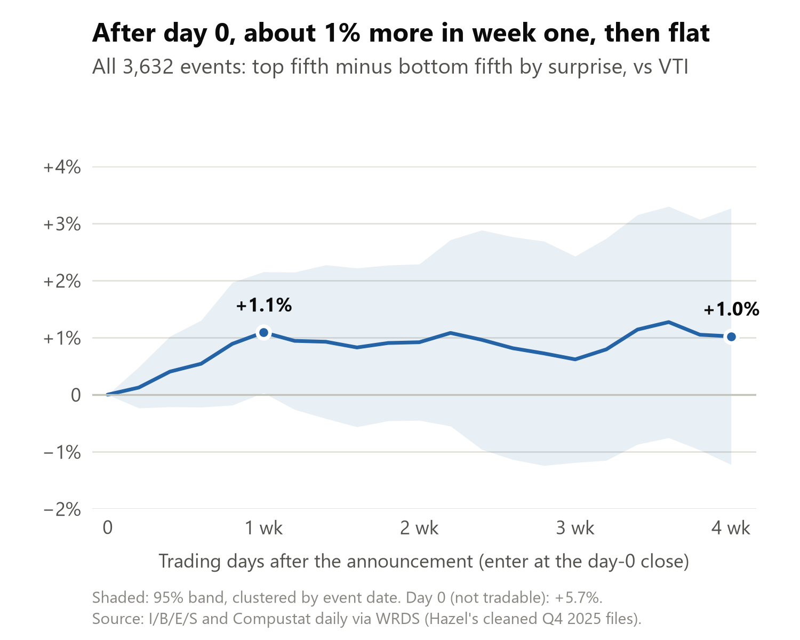

# Stage gate 1: the earnings surprise as a long-short

NTAM's brief asks for stage gate 1 "long short results with a focus on cumulative abnormal returns over
1 week, 4 week, 12 week horizons". Before there is an LLM signal, this measures what the plain earnings
surprise already earns over those horizons. That is the bar the LLM signal has to clear.

Code: `src/llm_based_earnings_surprise_ntam/signals/long_short.py` (the method) and
`scripts/long_short_q4_2025.py` (the Q4 2025 run). How to rerun: [section 6](#6-how-to-rerun).

---

## 1. The trade


- **Sample:** 3,632 Q4 2025 I/B/E/S announcements matched to Compustat daily prices (Hazel's cleaned
  files), and as a check the pipeline's 2,585 calls with transcripts.
- **Signal:** the surprise divided by the pre-announcement close, sorted into fifths.
- **Portfolio:** long the top fifth, short the bottom fifth, equal-weighted, entered at the **day-0
  close**. Day 0 is the first trading day investors can act on the release (16:00 ET rule), so the
  announcement-day move is reported but not traded.
- **Returns:** daily stock return minus VTI, summed over days 1–5, 1–20 and 1–60 (1, 4 and 12 weeks).
  t-stats are clustered by event date.

## 2. Result: most of it is priced on day 0



| Top − bottom fifth, all 3,632 | Spread (t-stat) |
|---|---|
| Day 0 (reaction, not traded) | +5.7% (t 12.0) |
| **1 week** | **+1.1% (t 2.0)** |
| 4 weeks | +1.0% (t 0.9) |
| 12 weeks* | +1.0% (t 0.3) |

\*Firms reporting by Nov 3 (1,339): the prices end on Jan 30, 2026.

- Week one builds over days 2–5 (+1.0%), not a slow day 1 (+0.1%).
- The surprise explains 5.7% of day-0 returns but 0.3% of week one (rank R²).

## 3. Large caps drift more, and for longer


| Large caps (US-incorporated, market cap ≥ $10bn) | Hazel's events (630) | Calls with transcripts (600) |
|---|---|---|
| **1 week** | **+2.4% (t 5.2)** | **+3.2% (t 8.9)** |
| 4 weeks | +2.2% (t 2.4) | +3.3% (t 3.5) |
| 12 weeks* | +4.3% (t 1.6) | +6.0% (t 2.4) |

\*Reported by Nov 3 (374 / 358).

- **Not a few names:** dropping the 10 best and 10 worst names per side still gives +2.3% at one week;
  the median spread is +2.05%; it is positive in each of the four busiest reporting weeks (+2.1%,
  +2.1%, +2.8%, +3.0%).
- **It sits at the top end:** one week is +1.2% for all US firms, +1.1% at $2bn and up, +2.4% at $10bn
  and up.
- **Caveat:** one quarter. It could be sector or factor exposure, so it needs industry adjustment and
  more quarters before we believe it.

## 4. Robustness and data checks

| Check (spread, t-stat) | 1 week | 4 weeks |
|---|---|---|
| Main: all 3,632 events | +1.1% (t 2.0) | +1.0% (t 0.9) |
| Cut-offs from earlier events only (3,237) | +1.2% (t 2.4) | +1.1% (t 1.2) |
| Buy-and-hold returns | +1.1% (t 2.0) | +0.9% (t 0.7) |
| Price ≥ $5 (3,022) | +1.1% (t 1.8) | +0.9% (t 1.1) |
| 2+ analysts (3,201) | +1.3% (t 2.1) | +1.6% (t 1.5) |
| Calls with transcripts (2,585, pipeline SUE) | +1.5% (t 2.4) | +0.8% (t 0.7) |

- **Cut-offs from earlier events only:** each event is ranked against surprises announced before it,
  which is what a live signal could do.
- **12 weeks** covers only firms reporting by Nov 3, which are bigger (median price $44 vs $15).
  Prices past January (CRSP) and more quarters fix that.
- **Compustat** has no dividend factor for about 40% of stocks, and some bad daily prints; window
  returns are winsorized at 1% and 99%. Without winsorizing, week one is unchanged.
- **No value weights:** Compustat's market cap is wrong for some ADRs (LATAM comes out at about $27
  trillion: local share count times the ADR price), so size cuts use US-incorporated firms.
- **Why Compustat:** CRSP daily on WRDS ends Dec 31, 2025, too early for 4- and 12-week windows on Q4
  events. On day 0 the two agree: the rank R² on the pipeline's calls is 4.8% with Compustat and 4.7%
  with CRSP (section 5 of `PIPELINE.md`).

## 5. What it means for the LLM signal

- **The bar:** an LLM long-short has to beat about 1% at one week (2–3% in large caps), after
  controlling for the surprise.
- **Same code, new signal:** rank on the LLM score from the LLM step (`LLM_README.md`) and double-sort
  on the surprise. The incremental R² there covers day 0; this covers 1, 4 and 12 weeks.
- **Next:** CRSP for 2024–25 through the pipeline (about 8 quarters instead of 1), industry and
  characteristic adjustment, calendar-time portfolios. Then stage gate 2: costs, turnover, long-only.

## 6. How to rerun

From the repo root (about a minute). Hazel's cleaned files are licensed WRDS data, so they stay outside
the repo, in `../data/processed`:

```bash
uv run python scripts/long_short_q4_2025.py ../data/processed <output folder> \
    --pipeline data/processed/earnings_calls_ibes_20251001_20251231_us.parquet
```

`--pipeline` adds the same test on the pipeline's in-sample calls (run `uv run doit` first). Outputs: a
results table with one row per check and window (`long_short_results.csv`), the large-cap stress test,
the charts and their numbers. To test another signal, call `long_short()` with your own quantiles: it
takes any score that ranks events.
