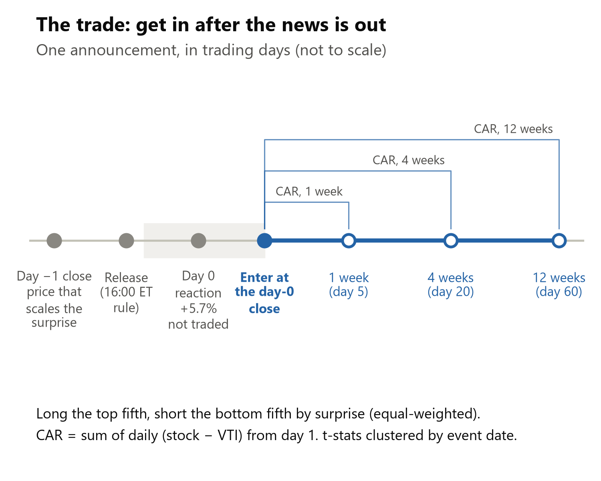
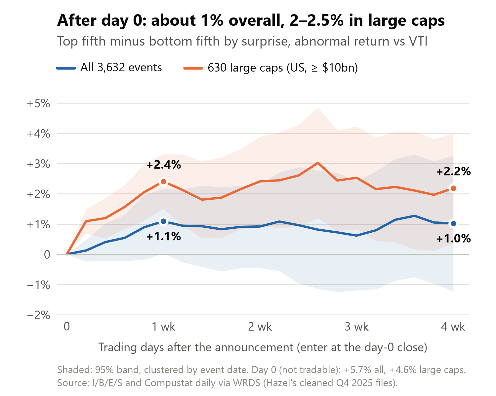

# Data pipeline: CIQ earnings-call transcripts + I/B/E/S earnings surprise

The pipeline builds the dataset the LLM work starts from: **one row per earnings call**, with the transcript text as it was available at the time, matched to its I/B/E/S earnings announcement (actual EPS, the analyst consensus before the release, the earnings surprise / SUE, and the trading day the market reacts on).

It runs on WRDS through [doit](https://pydoit.org). The tasks are in `dodo.py`, the code is in `src/llm_based_earnings_surprise_ntam/pipeline/`, and the settings are in `config.yaml`. The data checks behind each decision are in `notebooks/ibes_transcripts_link_eda.ipynb` (HTML version: `docs/ibes_transcripts_link_eda.html`).

---

## 1. How to run it

**One-time setup**
1. You need a WRDS account with access to Capital IQ Transcripts, I/B/E/S, Compustat and CRSP. Save your credentials in a `.pgpass` file; the first `wrds.Connection()` in Python offers to create it.
2. Install the environment from the repo root: `uv sync`

**Run**
```bash
uv run doit                                      # everything, using config.yaml (default: Q4 2025, US firms)
uv run doit start=2024-01-01 end=2024-12-31      # choose the call-date period (inclusive)
uv run doit universe=global                      # all countries instead of US only
uv run doit config=my_config.yaml                # use a different config file
```
`start`, `end` and `universe` on the command line override `config.yaml`. To change anything else, edit `config.yaml` (each option is commented there).

**Useful commands**
```bash
uv run doit list                       # list the tasks
uv run doit info merge                 # explain why a task would (or would not) rerun
uv run doit forget transcripts:2025-12 # re-pull a month that was still incomplete when first pulled
uv run doit clean                      # delete the outputs of the current period
```
The run is incremental. Each task reruns only when its inputs or its part of the config change. Monthly transcript pulls are cached in `data/raw` and reused when you change the period. One quarter of US calls takes about 30 seconds.

**Outputs** (in `data/`, which is not tracked by git)

| File | Contents |
|---|---|
| `processed/earnings_calls_ibes_<start>_<end>_<universe>.parquet` | **The final dataset** (one row per call) |
| `processed/..._report.json` | Match statistics for the run, plus the config used |
| `interim/calls_*.parquet`, `interim/transcript_text_*.parquet` | Cleaned transcript metadata and text |
| `interim/ibes_announcements_*.parquet` | IBES announcements with actual EPS and consensus |
| `interim/ibes_links_*.parquet` | Candidate IBES tickers for each call |
| `interim/matched_*.parquet` | Calls matched to IBES, with event date (before SUE) |
| `interim/prices_*.parquet` | Close on the trading day before each event date |
| `raw/ciq_transcripts_<universe>_<rule>_<YYYY-MM>.parquet` | Monthly WRDS pulls (cache) |

Read the final file with `pd.read_parquet(path)`. Filter on `matched` and/or `sue.notna()` for the estimation sample.

---

## 2. The process

```
  CIQ transcripts (WRDS)           I/B/E/S (WRDS)                   Link tables (WRDS)
          |                              |                                 |
  transcripts:YYYY-MM              ibes                             links
  earnings calls, one version      announcements, actual EPS,       CIQ company -> candidate
  per call, full text              pre-release consensus            IBES tickers (4 routes)
          |                              |                                 |
  transcripts_clean                      |                                 |
  period, length, duplicates             |                                 |
          \______________________________|_________________________________/
                                         |
                                       merge
                          match call <-> announcement, event date
                                         |
                                      prices
                        close on the trading day before the event date
                                         |
                                       final
                          SUE, within-quarter ranks, transcript text
                                         |
                         earnings_calls_ibes_<period>.parquet
```

### Step 1. Transcripts (`transcripts:YYYY-MM`, `transcripts_clean`)

**Source:** S&P Capital IQ Transcripts on WRDS (`ciq_transcripts`).

| Decision | What we do | Why |
|---|---|---|
| Which events | **Earnings calls only** (CIQ event type 48) | Other event types (M&A calls, investor days, conferences) are out of scope. |
| Which countries | `universe: us` keeps US-headquartered companies (CIQ company country). `global` keeps all. | The paper's sample is US. Outside the US, coverage of the surprise is much thinner. |
| Which version of the transcript | **Point-in-time (`version_rule: pit`): the first version created** for each call | A call has 2-4 versions (Preliminary, then Final edits, sometimes weeks later). A backtest must use the text that existed at the time. In Q4 2025 the chosen version appeared a median of about 1.3 hours after the call, and 98% within a day. `version_rule: final` picks the cleanest late version instead. |
| Text | Full text plus separate **prepared remarks** and **Q&A** sections. Each speaker turn is prefixed with name and role ("Jane Doe (Executive): ...") | The paper uses the full transcript. The sections allow separate prompts or features. |
| Period | Keep calls with call date in `[start, end]` | Set in config / on the command line. |
| Short transcripts | **Drop** if under 500 words (`min_words`) | Empty or truncated text. |
| Duplicate events | **Drop**: when CIQ lists the same company and date under two event IDs, keep the longer transcript | About 1% of calls are duplicated in CIQ. |
| Late transcripts | **Kept** by default. `max_lag_days: N` drops calls whose chosen version appeared more than N days after the call. | Old history was often backfilled years later. Whether to drop it depends on the backtest. |

### Step 2. I/B/E/S (`ibes`)

**Source:** I/B/E/S on WRDS: the US file, plus the international file for `global`. All tables are the **unadjusted** versions (`actu_`, `statsumu_`, `detu_`, `stopu_`), so actual and consensus are on the same per-share basis on the announcement date. Split-adjusted values are rounded and distort small surprises.

The defaults follow Koijen & Levy: the **mean** consensus **right before the release**, scaled by the **price just before the announcement**.

| Decision | What we do | Why |
|---|---|---|
| Unit of observation | One row per **announcement** (IBES ticker x announcement date) | A release can carry several actuals: a Q4 release also reports the annual figure. |
| Which actual | **Quarterly** EPS if present, else semi-annual, else annual | The consensus and SUE are quarterly. Semi-annual reporters (mostly Europe and Asia) are kept, but get no SUE. |
| Measure | IBES "street" EPS | It is on the same basis analysts forecast, so actual and consensus are comparable (not GAAP). |
| Consensus | Default `detail`: built from **individual analyst estimates** for the quarter. For each analyst, take the latest estimate that was (1) **made before the release** (an earlier day, or the release day before the release time), (2) **made or last confirmed within 90 days** (`detail_window_days`), and (3) **not stopped** by the broker before the release. Then take the mean (`consensus_stat`). Option `summary`: the last monthly IBES consensus snapshot before the release day. | The paper uses the consensus right before the release. The monthly snapshot is a median of about 20 days old and misses late revisions; in Q4 2025, using it instead changes beat/miss for about 9.5% of events. The detail rule drops estimates nobody has confirmed for 90+ days, which the monthly snapshot keeps, so it covers slightly fewer events (mostly 1-2-analyst firms). |
| Consensus currency | Dropped if the estimates are in a different currency than the actual | Not comparable. |

### Step 3. Linking companies (`links`)

CIQ has no IBES identifier, so each call gets **candidate IBES tickers** from four routes, each checked as of the call date:

| Route | Path | Mainly finds |
|---|---|---|
| CUSIP | CIQ CUSIP (first 8 characters) to IBES CUSIP | US and Canada (finds about 98% of US calls) |
| CCM | CIQ, then Compustat gvkey, then CRSP permno, then the WRDS IBES-CRSP link | US-listed stocks |
| Compustat `ibtic` | gvkey to Compustat's IBES ticker field | US and non-US |
| SEDOL (`global` only) | gvkey to Compustat SEDOL, matched to the IBES international identifier | Non-US |

When two routes both find a ticker, they agree 94-98% of the time. About 99% of calls get at least one candidate. The announcement date decides which candidate is correct (Step 4).

### Step 4. Matching, price and final dataset (`merge`, `prices`, `final`)

| Decision | What we do | Why |
|---|---|---|
| Match window | Accept an announcement if **call date minus announcement date is between -1 and +3 days** | 70% of calls are on the announcement day and 25% the next day (release after the close, call the next morning). The -1 / +2 / +3 days absorb time-zone differences. |
| Several candidates | Prefer: closest date (day-after over day-before), then the IBES record for the company's home market (home listing over a US ADR, or the reverse for US firms), then the strongest route | 0.4% of US matches have a tie; about 10% globally (ADRs). |
| One call per announcement | If two calls match the same announcement, keep the closer one, then the longer transcript | Leftover CIQ duplicates. |
| Unmatched calls | **Kept**, with `matched = False` and empty IBES fields | Lets you see coverage, and keeps the text for uses that do not need IBES. |
| Event date | The **release day if released by 16:00 ET on a trading day, otherwise the next trading day** (NYSE calendar). US companies only. | The paper's rule. This is the day of the return you would explain. It equals the call date only about 64% of the time. |
| Price | **Close on the trading day before the event date** (the t-1 close), from Compustat daily prices (`comp.secd`), primary US share line, unadjusted. If unavailable, fall back to the last IBES price snapshot. `price_source` records which was used. `ibes.price_source: ibes` uses the IBES price throughout. | The paper scales by the price just before the announcement. For a release after the close this is that day's close; for a pre-market release, the previous day's close. In Q4 2025, 99.8% of SUEs use the t-1 close. |
| SUE | `(actual - consensus) / price` | The paper's surprise; the baseline the LLM signal must beat. |
| SUE left missing | No consensus, price below $1 (`min_price`), or the price is in a different currency than the actual | Penny-stock prices make SUE explode. |
| Transcript availability | `transcript_by_event_close`: was the chosen version created by 16:00 ET on the event date? | 90% are. Filter on it if the text must be available by the close. |
| SUE rank | `sue_pct`: percentile of SUE within the event quarter | The paper ranks surprises within the quarter. |

---

## 3. What the data looks like (Q4 2025, US, default config)

**Flow of calls**

| Stage | Calls |
|---|---|
| US earnings calls in CIQ, Oct-Dec 2025 (one version each) | 3,009 |
| after dropping transcripts < 500 words | 3,008 |
| after dropping duplicate CIQ events | 2,998 |
| after keeping one call per IBES announcement | **2,995** (final rows) |
| matched to an IBES announcement | 2,864 (95.6%) |
| with a SUE | 2,602 (86.9%) |

**Why some rows have no SUE:** 131 calls have no IBES announcement in the window. Among matched calls, the gaps overlap, so the counts don't add up: 210 have no consensus (no analyst estimate made or confirmed in the 90 days before the release), 107 have no reported actual, 73 have a price below $1, and 2 have no price.

**Typical values:** a transcript has a median of 6.3k words. A consensus has a median of 5 analysts, and the most recent estimate in it was made a median of 24 days before the release (older estimates count if they were confirmed since). The chosen transcript appeared a median of about 1.3 hours after the call, and 98% within a day. The event date is the call date 64% of the time and the next trading day 35% of the time.

**Columns of the final file (57)**

| Group | Columns |
|---|---|
| Call identifiers | `keydevid` (CIQ event), `transcriptid` (chosen version), `companyid`, `gvkey` (Compustat), `companyname`, `headline`, `country` |
| Call timing | `call_date`, `call_time_utc`, `call_datetime_utc` |
| Transcript version | `presentation_type` (Preliminary / Final), `collection_type`, `created_utc`, `transcript_lag_days`, `n_versions`, `first_created_utc` |
| Transcript text | `full_text`, `presentation_text`, `qa_text` (set `output.include_text: false` to drop them) |
| Transcript stats | `n_words`, `n_words_presentation`, `n_words_qa`, `n_components`, `n_questions`, `n_analysts`, `audio_sec` |
| Link | `matched`, `ticker` (IBES), `link_route`, `routes`, `ibes_file` (US / Intl), `match_gap_days`, `ticker_tie` |
| Announcement | `anndats`, `anntims` (ET), `pdicity` (QTR / SAN / ANN), `pends` (fiscal period end) |
| Earnings | `actual`, `curr_act`, `consensus` (the configured statistic), `consensus_mean`, `consensus_median`, `consensus_std`, `n_estimates`, `consensus_date` (most recent estimate, or the snapshot date for `summary`), `consensus_age_days` |
| Surprise | `surprise` (actual - consensus), `price`, `price_date`, `price_source` (t-1 close or IBES snapshot), `price_ibes`, `price_ibes_date`, `sue`, `sue_pct`, `event_quarter` |
| Event | `event_date`, `transcript_by_event_close` |

A quarter of US calls with text is about 120 MB as parquet.

---

## 4. Known limitations

- **IBES on WRDS lags by about 7 weeks** (monthly refresh; currently through 2026-08-20). Calls after that date cannot match, and the run prints a warning. This suits historical work but not the paper's live design.
- **The latest month can be incomplete.** CIQ keeps adding transcripts for recent calls. Re-pull with `doit forget transcripts:YYYY-MM`.
- **Some misses are data disagreements, not bugs.** Examples: an IBES date set by a preliminary release a week before the call (Skyworks, Q4 2025), or a company whose identifiers changed after a merger (fuboTV). We do not fuzzy-match on names or tickers, to avoid wrong matches.
- **Non-US (`universe: global`):** about 90% of calls match, but only about half get a SUE (semi-annual reporters, thin analyst coverage), and `event_date` is left empty (NYSE calendar only).
- **The consensus vendor differs from the paper.** The paper's main source is Benzinga; IBES is the paper's own robustness source. The consensus rule here is as close as IBES allows, but small differences remain (which analysts count, and how long an estimate stays valid).
- **Returns are not included yet.** Abnormal returns on `event_date` (e.g. from Compustat daily prices, as used for the SUE price) are the next step.

---

## 5. Extension: event-date abnormal return and explanatory-power baseline check

Two tasks added on top of the pipeline above (`returns`, `sample`). They produce the dependent variable the LLM work needs — the abnormal return around the announcement — and check that the dataset is aligned before any LLM money is spent. This supersedes the last bullet of section 4 ("Returns are not included yet").

Nothing in the existing pipeline code changed: the steps are two new modules (`pipeline/returns.py`, `pipeline/sample.py`) wired in through `dodo.py`, with their settings in the new `returns:` and `sample:` sections of `config.yaml`.

### How to run it

`doit` now runs through `sample` by default, so the usual command does everything:

```bash
uv run doit                      # transcripts -> ... -> final -> returns -> sample
uv run doit returns              # just the returns step
uv run doit sample               # just the sample step (re-runs `final` first if needed)
```

Both steps are incremental like the rest: `returns` reruns when `matched`/`prices` or the `returns:` config change; `sample` reruns when the returns file or the `sample:` config change, **or when the columns it adds are missing from the final parquet** (which happens whenever `final` rewrites it).

### Step 5. Abnormal return (`returns`)

**Source:** CRSP daily v2 (`crsp.dsf_v2`), column `dlyret` — total return, dividends included.

| Decision | What we do | Why |
|---|---|---|
| Return table | `crsp.dsf_v2`, not `crsp.dsf` | The classic CRSP daily files (`crsp.dsf`, `crsp.dsi`, `crsp.dsix`) **stop at 2024-12-31** on WRDS and cannot cover recent quarters. The v2 file runs to 2025-12-31. |
| Market proxy | **VTI** (CRSP permno 90878), `returns.market_permno` | The ETF Koijen & Levy use. CRSP's own value-weighted index (`vwretd`) would be the usual substitute, but its daily file ends in 2024. |
| Abnormal return | `r_abn = ret − mkt_ret` on `event_date` | The paper's market-adjusted return, a one-day window. Using CRSP's `ret` rather than differencing the unadjusted Compustat closes keeps dividends and splits handled. |
| gvkey → permno | `crsp.ccmxpf_lnkhist`, primary links only (`linktype LU/LC`, `linkprim P/C`), valid **on the event date**; `P` preferred, lowest permno breaks ties | Same link the `ccm` route uses, but it is re-derived here so `links.py` is untouched. `n_permno_candidates` records how many permnos the call had. |
| Which calls | Matched calls with an `event_date` and a `gvkey` | Without an event date there is no day to measure, and non-US calls have no event date (section 4). |
| Sanity check | Compares `close / price − 1` (event-day close over the t−1 close already used for the SUE) with `dlyret`, and prints how many differ by more than 1pp | Catches a misaligned event date, a wrong permno, or a split/dividend on the event day. |

Output: `interim/returns_<period>.parquet` — `keydevid, permno, event_date, ret, mkt_ret, r_abn, n_permno_candidates`.

### Step 6. Estimation sample and baseline check (`sample`)

Adds seven columns **to the existing final parquet, in place** (row order and existing columns untouched; a rerun replaces these columns rather than duplicating them):

| Column | Meaning |
|---|---|
| `permno`, `ret`, `mkt_ret`, `r_abn` | from the returns step |
| `in_sample` | passes every filter below — the rows to estimate on |
| `r_abn_pct` | percentile rank of `r_abn` within `event_quarter`, over `in_sample` rows only |
| `sue_pct_sample` | percentile rank of `sue` within `event_quarter`, **re-ranked over `in_sample` rows** (the pipeline's own `sue_pct` is ranked over all rows of the file, so it is not the right regressor once rows are dropped) |

Sample filters, printed as a chain so you can see where rows go:

| Filter | Setting |
|---|---|
| `matched` | fixed |
| `sue` present | fixed |
| `r_abn` present | fixed |
| `transcript_by_event_close` | `sample.require_transcript_by_event_close` (default `false`) |

**The baseline check.** The task then runs the surprise-only regression that the LLM has to beat:

```
PRank(r_abn) = a + b * PRank(sue)
```

and prints `N`, `b`, its t-statistic and the R². Koijen & Levy report **b = 0.219 and R² = 5.0%** for this regression (Table 2, column 1). The R² is a single check on the event date, the ticker match, the consensus and the returns at once: if any of them is misaligned, it collapses toward zero.

When the R² falls below `sample.baseline_r2_warn` (default 0.05) the task prints a **WARNING**. Treat it as "look before going further", not as a hard failure — a value a little under 5% is expected, since this sample is not the paper's (I/B/E/S instead of Benzinga, a different market proxy, and about 2,600 calls against their 1,849).

### Current run (Q4 2025, US, default config)

**Where the rows go.** The two steps print two different chains, so their counts do not line up row for row:

| Rows | Filter | Step | Note |
|---|---|---|---|
| 2,995 | all calls in the final file | — | unmatched calls included |
| 2,865 | `matched` | `sample` | 95.6% of calls. `matched` means the call was successfully paired with an IBES earnings announcement (step 4). |
| 2,864 | `matched` & `event_date` & `gvkey` | `returns` | the one call dropped here has no `gvkey`, so there is no security to price. No US call lacks an event date; that only bites with `universe: global`. |
| 2,827 | of those, CRSP had a return | `returns` | 98.7%; a permno was found for 98.8% |
| 2,603 | `matched` & `sue` | `sample` | a SUE also needs a consensus and a price >= `ibes.min_price` |
| **2,586** | **`in_sample`** — also has `r_abn` | `sample` | the 17 calls lost here have a SUE but no permno (firms absent from CRSP: recent IPOs, foreign private issuers, trusts) |

The two chains overlap but are not nested: `r_abn` exists for 2,827 matched calls, more than the 2,603 with a SUE, because a return only needs a permno while a SUE also needs a consensus and a valid price.

| Other checks | |
|---|---|
| Price cross-check beyond 1pp | 2 of 2,826 |
| Abnormal return | mean 0.07%, SD 11.0% (paper's Table 1: SD 11%) |
| **Baseline regression** | b = 0.217 (t = 11.3), **R² = 4.7%** on N = 2,586 |

The slope is within 0.002 of the paper's 0.219 and the R² within 0.3pp of its 5.0%, on a different quarter and a different consensus vendor — the dataset lines up.

An independent rebuild of this regression from Compustat prices and the monthly I/B/E/S snapshot, and a test that the surprise explains returns best on the event day itself, are in [section 7.1](#71-independent-baseline-and-event-date-alignment).

### Known limitations of the extension

- **CRSP daily v2 ends 2025-12-31** on WRDS. Calls with a later event date get no return; the task warns when that happens.
- **Non-US calls get no return**, because they have no `event_date` (NYSE calendar only, section 4).
- **One-day window only.** The project's longer horizons (1, 4, 12 weeks) would need cumulative returns, which these tasks do not compute.
- **VTI is an ETF, not an index.** Its return includes a tracking difference and its own dividend timing. The effect on a one-day market-adjusted return is small, but it is not identical to a value-weighted market return.
- **The `price` column is still the t−1 close** used for the SUE; the event-day close is not stored as a column, only used inside the cross-check.

---

## 6. Stage gate 1: the surprise as a long-short at 1, 4 and 12 weeks

Section 5 checks the surprise on the event day only ("one-day window only"). Stage gate 1 of our proposal asks for "long short results with a focus on cumulative abnormal returns over 1 week, 4 week, 12 week horizons". This section runs that test on the plain earnings surprise, before any LLM signal: a post-earnings-announcement drift (PEAD) test of how much of the surprise is still tradable after the event day. That is the bar an LLM long-short has to clear.

**Result (Q4 2025):** most of the surprise is priced on the event day. After the day-0 close, the top fifth beats the bottom fifth by about **1% in the first week**, then nothing measurable. **US large caps are the exception: +2.4% in week one (t 5.2), still +2.2% at four weeks.** It is one quarter, so interesting, not proven.

The method is in `src/llm_based_earnings_surprise_ntam/signals/long_short.py` (it takes any signal that ranks events), and this run is `scripts/long_short_q4_2025.py`. It is a script, not a `doit` task yet.

### How to run it

```bash
uv run doit                                    # the pipeline (needed for --pipeline)
uv run python scripts/long_short_q4_2025.py ../data/processed <output folder> \
    --pipeline data/processed/earnings_calls_ibes_20251001_20251231_us.parquet
```

The first argument is the folder with Hazel's cleaned Q4 2025 files (`events_baseline.parquet`, `prices_clean.parquet`, `market_ret.parquet`). They are licensed WRDS data, so they stay outside the repo; how they are built and checked is in [section 7.2](#72-the-compustat-price-panel-behind-section-6). `--pipeline` adds the same test on this pipeline's `in_sample` calls. A run takes about a minute and writes `long_short_results.csv` (one row per check and window), `long_short_large_cap_stress.csv`, `long_short_path.csv` (the charts' numbers) and the charts.

### The trade



| Decision | What we do | Why |
|---|---|---|
| Events | **3,632** Q4 2025 I/B/E/S announcements with Compustat daily prices (Hazel's cleaned files). Check: this pipeline's **2,585** `in_sample` calls, on the same prices | CRSP daily v2 ends 2025-12-31 (section 5), too early for 4- and 12-week windows on Q4 events. Compustat runs to 2026-01-30. |
| Signal | **Surprise ÷ the close before the event date**, sorted into **fifths within the quarter**. Hazel's surprise uses the mean of the last monthly I/B/E/S consensus before the release; the pipeline check uses `sue` (analyst-level consensus, step 2) | The paper's surprise. Two consensus rules, so the check also tests the consensus. |
| Portfolio | **Long the top fifth, short the bottom fifth, equal-weighted**: 727 names per side | Value weights are unreliable in this file (see the limitations). |
| Entry | **The close of `event_date` (day 0)** | The day-0 reaction comes before a signal built on the release can trade, so it is reported but not traded. 90% of transcripts exist by 16:00 ET on the event date (step 4), so an LLM signal can trade at the same close. |
| Return | Daily stock return **minus VTI**, summed over days 1–5, 1–20 and 1–60: the **CAR** at 1, 4 and 12 weeks. Buy-and-hold as a check | The market adjustment of step 5, over the brief's horizons. |
| Missing daily returns | Set to VTI's return (no abnormal return that day) | 1,182 of about 202,000 daily returns inside the windows. |
| Outliers | Window returns winsorized at 1% and 99% | Compustat has some bad daily prints (57 daily moves beyond ±50%). |
| t-statistics | Window return regressed on a top-fifth dummy (top and bottom fifths only), **standard errors clustered by event date** (59 dates) | Events on the same day share market and industry shocks. |

### Results (Q4 2025)



Top fifth minus bottom fifth, abnormal return vs VTI, % (t-statistic):

| Window | All events (3,632) | US large caps (630) | Pipeline calls (2,585) | Pipeline large caps (600) |
|---|---|---|---|---|
| Day 0 (reaction, not traded) | +5.7 (12.0) | +4.6 (5.7) | +5.7 (7.8) | +3.8 (3.7) |
| **1 week** (days 1–5) | **+1.1 (2.0)** | **+2.4 (5.2)** | **+1.5 (2.4)** | **+3.2 (8.9)** |
| 4 weeks (days 1–20) | +1.0 (0.9) | +2.2 (2.4) | +0.8 (0.7) | +3.3 (3.5) |
| 12 weeks (days 1–60)\* | +1.0 (0.3) | +4.3 (1.6) | +3.9 (1.7) | +6.0 (2.4) |

Large caps: US-incorporated, market cap ≥ $10bn the day before the event. Each sample is sorted into its own fifths. \*Only events up to 2025-11-03 have 60 trading days of prices (1,339 / 374 / 1,011 / 358 events): [12-week chart](docs/long_short/long_short_chart_12w.png).

- **Most of it is priced on day 0.** The surprise explains 5.7% of day-0 returns but 0.3% of week one (rank R², the regression of step 6). The week-one gain builds over days 2–5 (+1.0%), not on day 1 (+0.1%).
- **Large caps drift more, and for longer**, on both datasets. It is not a few names: dropping the 10 best and 10 worst per side still gives +2.3%, the median spread is +2.05%, and it is positive in each of the four busiest reporting weeks (+2.1%, +2.1%, +2.8%, +2.9%). It is a top-end effect: +1.2% for all US-incorporated firms, +1.1% at $2bn and up, +2.4% at $10bn and up.
- **Why we don't believe it yet:** the literature says large-cap drift is gone. [Martineau (2022)](https://papers.ssrn.com/sol3/papers.cfm?abstract_id=3111607), "Rest in Peace Post-Earnings Announcement Drift", finds none in large caps since 2006: prices react fully on the announcement day. It is not an industry bet ([section 7.4](#74-is-the-stage-gate-1-spread-an-industry-bet)), but one quarter could still be factor exposure, so it needs characteristic adjustment and more quarters.

### Robustness

| Check: top − bottom fifth, % (t) | 1 week | 4 weeks |
|---|---|---|
| Main: all 3,632 events | +1.1 (2.0) | +1.0 (0.9) |
| Fifths from earlier events only (3,237) | +1.2 (2.4) | +1.1 (1.2) |
| Buy-and-hold returns | +1.1 (2.0) | +0.9 (0.7) |
| No winsorizing | +1.1 (2.0) | +0.8 (0.5) |
| Clustered by reporting week | +1.1 (2.2) | +1.0 (0.6) |
| Deciles: top − bottom tenth | +1.1 (2.0) | +2.0 (1.3) |
| Price ≥ $5 (3,022) | +1.1 (1.8) | +0.9 (1.1) |
| 2+ analysts (3,201) | +1.3 (2.1) | +1.6 (1.5) |

"Fifths from earlier events only" ranks each event against the surprises announced before it (from the 251st event on), which is what a live signal could do. Subsamples are re-sorted into fifths.

### Known limitations

- **One quarter:** 59 event dates, with 86% of events in four weeks. Overlapping windows make the 4- and 12-week t-statistics optimistic. More quarters and calendar-time portfolios fix both.
- **12 weeks covers only early reporters** (up to Nov 3), which are bigger (median price $44 vs $15).
- **Market-adjusted only:** no size or characteristic adjustment yet. [Section 7.4](#74-is-the-stage-gate-1-spread-an-industry-bet) redoes the test industry-neutral, using the mapping in [section 7.3](#73-fama-french-12-industries).
- **Gross returns:** no commissions, spreads, borrow fees or market impact, and every trade fills at the day-0 close. Break-even is about **0.27% per trade** for all events (the 1.1% one-week spread over four trades: buy, sell, short, cover) and about **0.6%** for large caps. Costs and a realistic simulation are stage gate 2.
- **Compustat, not CRSP:** no dividend factor for about 40% of stocks (price return only). On day 0 the sources agree: on this pipeline's calls the rank R² is 4.8% with Compustat and 4.7% with CRSP (step 6).
- **No value weights:** Compustat's market cap is wrong for some ADRs (LATAM comes out at about $27 trillion: the local share count times the ADR price), so size cuts use US-incorporated firms.
- **Not a `doit` task yet:** it runs on Hazel's files. The next version runs on the CRSP returns of step 5.

### What it means for the LLM signal

- **The bar:** an LLM long-short has to beat about **1% at one week (2–3% in large caps)**, after controlling for the surprise.
- **Same code, new signal:** the functions take any score that ranks events, so the LLM score from the LLM step ([LLM_README.md](LLM_README.md)) drops in directly, then a double sort on `sue`. The LLM step's incremental R² covers day 0; this covers 1, 4 and 12 weeks.

  ```python
  from llm_based_earnings_surprise_ntam.signals.long_short import event_paths, long_short, quantile
  # returns: daily returns, one row per security and one column per trading day; market: VTI on the same days
  stock, mkt, _ = event_paths(keys, event_dates, returns, market)     # days 0-60 after each event
  long_short(stock, mkt, quantile(score), event_dates, signal=score)  # one row per window
  ```

- **Next:** CRSP for 2024–25 through this pipeline (about 8 quarters instead of 1), size and characteristic adjustment, calendar-time portfolios. Then stage gate 2: costs, turnover, long-only.
- **Open question:** for stage gate 1, should we focus on one week in large caps, or on 4–12 weeks?

---

## 7. Replication checks and industry mapping

Three additions that sit next to the pipeline. They come from an independent replication built on Compustat prices.

### 7.1 Independent baseline and event-date alignment

The same surprise-only regression as section 5, rebuilt from different sources:

| | Section 5 (this pipeline) | Independent check |
|---|---|---|
| Events | 2,586 `in_sample` calls (a transcript is required) | 3,632 I/B/E/S announcements (no transcript requirement) |
| Returns | CRSP `dlyret` | Compustat daily prices: total return where the dividend factor exists, otherwise price return |
| Consensus | analyst-level, built right before the release | last monthly I/B/E/S snapshot (median about 19 days old) |
| Surprise-only R² | 4.7% (b = 0.217) | **5.7%** (b = 0.239; 99% bootstrap interval 3.7% to 7.7%) |

The paper reports 5.0% (b = 0.219). Three things differ at once (returns, consensus, sample), so agreement is a consistency check, not a like-for-like replication. The independent R² stays between 5.4% and 6.3% when the sample is restricted to two or more analysts, a price of at least $5, or both.

**Alignment test.** If the event date, the time zone and the returns line up, the surprise should explain abnormal returns best on the event day and little on the days around it. R² of the abnormal-return rank on the surprise rank, by trading-day offset from `event_date`:

| Offset (trading days) | −2 | −1 | **0** | +1 | +2 |
|---|---|---|---|---|---|
| R² | 0.002 | 0.001 | **0.057** | 0.001 | 0.001 |

The two release-time groups are tested separately, because a wrong event-date rule can hurt one group and hide in the pooled result. Announcements at or before 16:00 ET peak on day 0 (R² 0.068) and so do those after 16:00 (0.050). I/B/E/S announcement times are U.S. Eastern clock times.

### 7.2 The Compustat price panel behind section 6

Section 6 needs returns after 2025-12-31, where CRSP daily v2 ends (section 5), so it uses a cleaned Compustat panel. The files are `events_baseline.parquet`, `prices_clean.parquet` and `market_ret.parquet`.

| Step | What |
|---|---|
| Source | Compustat daily security file (WRDS export), 2025-09-02 to 2026-01-30: 105 trading days, the days VTI traded |
| Filter | Drop rows with a missing or non-positive close, and non-USD securities: 2.17M rows become 1.79M |
| Return | Close to close. Total return (dividend factor) where it exists on both days, otherwise split-adjusted price return: 62% and 38% of returns. A return needs the previous record to be the previous trading day and the previous close to be at least $0.01. Nothing is imputed |
| Market | VTI, from the same file |

Checks:
- A market built from the panel's own stock returns (cap-weighted, U.S. common stocks) correlates 0.998 with VTI; cumulative return 7.3% against 8.4%.
- **Truncation test.** The features are recomputed with all data after a cutoff date removed. Everything up to the cutoff is identical (0 mismatches in 38,555 rows), while a deliberately leaky feature is detected, so the test can see leakage.
- On this pipeline's calls the day-0 rank R² is 4.8% with Compustat returns and 4.7% with CRSP (section 6).

Limits: the panel ends 2026-01-30, so 12-week windows exist only for early reporters (section 6). It is licensed data and stays outside the repo. The cleaning notebooks are not in the repo yet.

### 7.3 Fama-French 12 industries

`src/llm_based_earnings_surprise_ntam/signals/ff12.py` maps a SIC code to one of Kenneth French's 12 industries (NoDur, Durbl, Manuf, Enrgy, Chems, BusEq, Telcm, Utils, Shops, Hlth, Money, Other). The paper reports its sample by this classification (Table 1). It is the first step of the industry adjustment that section 6 lists as missing.

```python
from llm_based_earnings_surprise_ntam.signals.ff12 import ff12_name
df["industry"] = ff12_name(df["sic"])     # a missing or invalid SIC gives NaN
```

```bash
uv run python -m llm_based_earnings_surprise_ntam.signals.ff12     # self-test: 20 spot checks, no overlapping ranges
```

- **The pipeline's final file has no SIC column.** It is available as `sic` in the Compustat panel above, or from Compustat by `gvkey`.
- **SIC is the value at the download date**, not on each event date. That is fine for grouping, but it is not point-in-time.
- The SIC ranges come from a public copy of French's definition file and were checked against a second public listing only for the first nine industries. Check Health and Money against French's website before relying on them for published results.

### 7.4 Is the stage gate 1 spread an industry bet?

Section 6 sorts every event into one pool, so a leg can end up overweight one industry. It is: Health is 35.9% of the top fifth and 25.3% of the bottom, against 19.5% of all events. This check repeats the test two more ways, using the industries of section 7.3.

| Variant | Fifths formed | Return measured against |
|---|---|---|
| As in section 6 | one pool | VTI |
| Industry-neutral | inside each industry, legs pooled afterwards | VTI |
| Industry-adjusted | one pool | the industry's own equal-weighted return |

Top fifth minus bottom fifth after the day-0 close, % (t-statistic):

| Variant | All events, 1 week | All events, 4 weeks | US large caps, 1 week | US large caps, 4 weeks |
|---|---|---|---|---|
| As in section 6 | +1.1 (2.0) | +1.0 (0.9) | **+2.4 (5.2)** | +2.2 (2.4) |
| Industry-neutral | +0.6 (1.8) | +0.5 (0.6) | **+2.7 (3.5)** | +2.8 (1.8) |
| Industry-adjusted | +1.1 (1.8) | +1.3 (0.9) | **+2.5 (5.7)** | +1.7 (1.6) |

- **The large-cap spread is not an industry bet.** One week survives both variants (+2.7% and +2.5% against +2.4%).
- **Part of the all-events spread is.** Sorting inside industries halves one week, from +1.1% to +0.6%.
- **Day 0 is unchanged** by either variant: the surprise-only rank R² is 5.7%, 5.6% and 5.5%. This matches the paper's remark that the earnings surprise explains returns about equally well across industries.

The paper reports industry heterogeneity in how well an LLM explains same-day returns and forms no portfolios, so these numbers have no counterpart in it.

```bash
uv run python scripts/industry_neutral_long_short.py <folder with the cleaned files> out
```

Also writes `industry_neutral_results.csv` (every variant and window) and `industry_concentration.csv` (each industry's share of each leg).

**Limits**, on top of section 6's (one quarter, gross returns, no size or characteristic adjustment): the industry-neutral variant drops industries with too few events (303 of 3,632 events for all events; the threshold is a command-line option), so its sample is not identical to the other two rows. 12-week windows are left out: with 60 trading days of prices only for early reporters, the industry-neutral legs fall to about 60 events a side. The industry benchmark is the equal-weighted return of the panel's investable US common stocks in that industry, which the script checks against VTI (its daily mean is within 0.1pp), because the raw panel includes placeholder prices that make the mean meaningless. SIC is the value at the download date, as in section 7.3.
