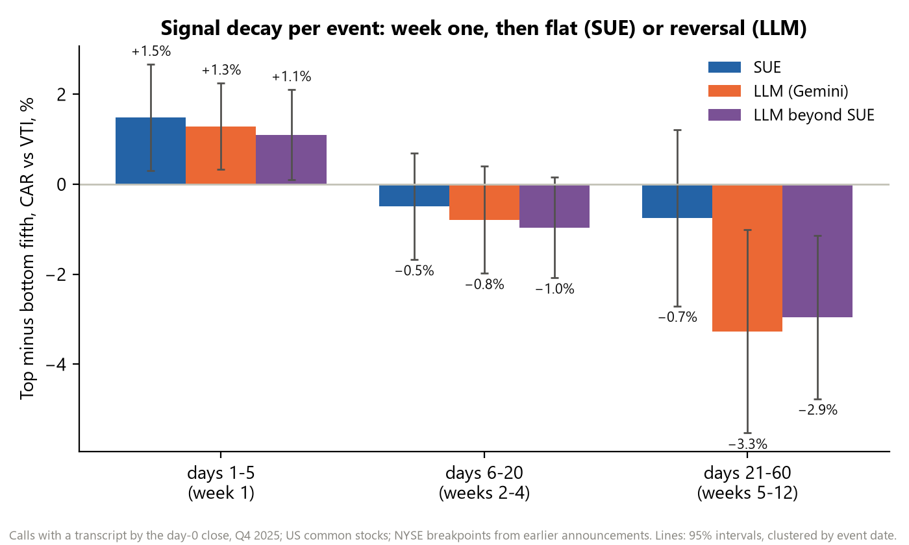
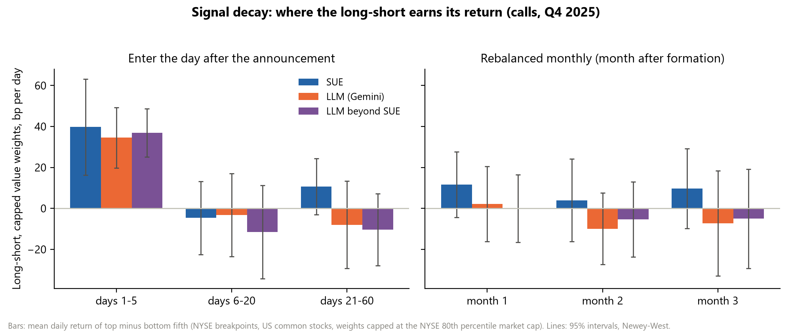
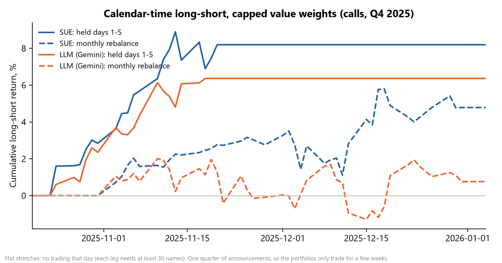
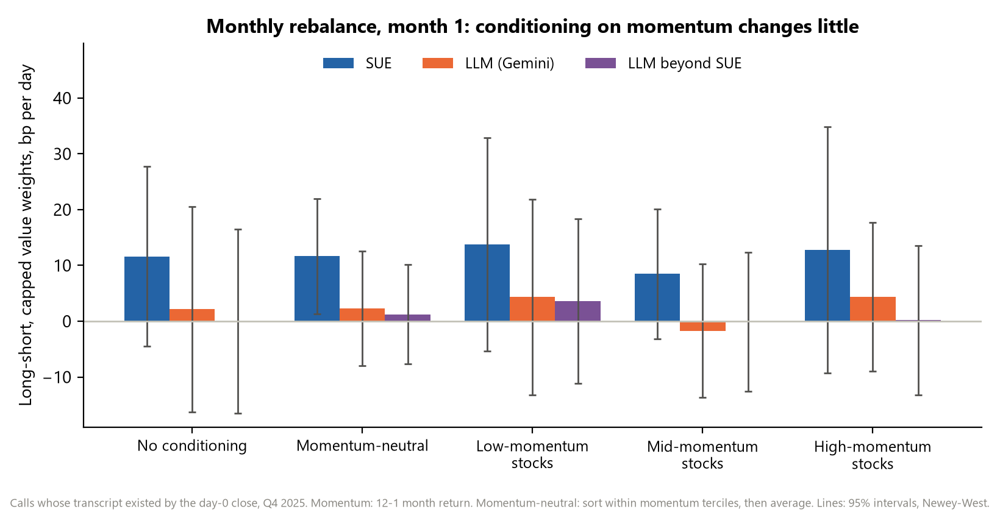

# Factor backtest: the earnings surprise and the LLM score as factors

*Q4 2025 earnings announcements. NTAM project lab (UChicago FINM 36000), prepared for the Nov 11, 2026 meeting, in
response to NTAM's questions of Nov 9 and Nov 10. Every number below comes from the backtest output; tables state
their units.*

## Summary

| Question | Answer (Q4 2025) |
|---|---|
| How fast does the signal decay? | **Fast.** Per event, both signals earn their return in the first week after the announcement: +1.5% for SUE and +1.3% for the LLM score (top minus bottom fifth). After that SUE goes flat, while the LLM long-short **reverses** by weeks 5–12: −3.3% (t −2.8), negative in every busy reporting week. The small dip in weeks 2–4 isn't robust. |
| Can a monthly rebalance capture it? | **No.** At the month-end rebalance the median stock is already 11 trading days past its announcement (10th to 90th percentile: 1 to 17). Month-1 long-shorts are close to zero: +2.1 bp a day for the LLM score (t +0.2), +11.6 for SUE (t +1.4). Months 2 and 3 are also close to zero. |
| Does conditioning on price momentum help? | **Not for the LLM score:** +2.3 bp a day momentum-neutral (t +0.4). For SUE a little: +11.7 bp a day (t +2.2), short of t > 3. |
| Can we add options-implied data? | We have OptionMetrics on WRDS, but it currently ends on 2025-08-29, before the Q4 2025 events, so it isn't in this backtest. It covers 2024 to mid-2025, so it can go on the earlier quarters (section 11). |
| Does anything clear the t > 3 hurdle? | Per event, only parts of the LLM reversal: LLM (Qwen), weeks 2–4 (t −3.4); LLM beyond SUE, weeks 5–12 (t −3.2). In calendar time, 13 of 180 portfolio tests clear it, all week-one portfolios that trade on only 16–22 days. With legs of 10 or more names (instead of 30), 0 do. |
| Main limitation | One quarter of announcements, most of them within four weeks. The shape of the decay is clear. Its size, and whether the reversal is real, need more quarters. |

**Reading the tables.** "bp per day (t)" is the mean daily long-short return in basis points, with its Newey-West t
statistic. "% (t)" is a per-event cumulative abnormal return. **Bold** means |t| ≥ 3 (Harvey, Liu and Zhu). Unless a
table says otherwise: US common stocks, NYSE breakpoints, and weights capped at the NYSE 80th percentile of market
cap (section 2.4).

**Contents:**

1. What we test
2. Method
3. Signal decay per event
4. Calendar-time portfolios, entering after the announcement
5. Monthly rebalancing
6. Conditioning on price momentum
7. Factor exposure
8. Fama-MacBeth regressions
9. Weighting and concentration
10. Limitations
11. Next steps
12. Appendix: reproducibility

---

## 1. What we test

| Signal | Definition | Sample |
|---|---|---|
| SUE, all I/B/E/S events | (actual EPS − mean consensus) ÷ the close before the event date. I/B/E/S, last monthly consensus before the release | 3,081 announcements |
| SUE, calls | The same surprise from our pipeline: analyst-level consensus built right before the release | 2,262 calls whose transcript existed by the day-0 close |
| LLM (Gemini) | Gemini 2.5 Flash-Lite's 0–1 prediction of the stock reaction, scoring its own summary of the anonymized call (run through NTAM's OpenRouter key) | the calls |
| LLM (Qwen) | Qwen3-30B, same task, run locally on the university cluster (a check on the Gemini run) | the calls |
| LLM beyond SUE | The part of the LLM score that SUE doesn't explain: the residual from regressing rank(LLM) on rank(SUE) within each formation set | the calls |

Q4 2025 is after both models' training cutoffs, which limits look-ahead. The three questions are the ones NTAM asked on Nov 10: how fast the signal decays, whether a monthly rebalance captures it, and whether conditioning on price momentum
changes that. The tests follow the protocol NTAM sent the same day.

---

## 2. Method

### 2.1 Data and universe

| Protocol item | CRSP version (NTAM's protocol) | What we use |
|---|---|---|
| Common stocks | shrcd 10/11 | Compustat `tpci` "0" (common) and `fic` "USA" (US-incorporated), the company's primary issue |
| Exchanges | exchcd 1/2/3 (NYSE, AMEX, Nasdaq) | Compustat `exchg` 11/12/14 |
| Daily returns | CRSP daily | Compustat daily (`comp.secd`), Sep 2, 2025 to Apr 30, 2026: total return where a dividend factor exists, else split-adjusted price return. CRSP on WRDS ends Dec 31, 2025, before our holding periods end |
| Delisting returns | Shumway | −30% (NYSE/AMEX) or −55% (Nasdaq) on the first missing day of a security that Compustat deleted for bankruptcy or liquidation. 207 securities qualify, none inside any holding window |
| Market and factors | | VTI. Fama-French 5 factors and momentum, daily, from Ken French's data library |

That gives 4,029 securities. A missing daily return inside a holding period earns VTI's
return.

### 2.2 Sorting

- Quintiles (fifths) of the signal, with breakpoints from NYSE stocks only.
- **No look-ahead:**
    - The event-time portfolios (section 4) take breakpoints from all announcements up to that day. At least 50 NYSE
      announcements are needed, so the first days of the quarter have no portfolio.
    - The monthly portfolios (section 5) take them from that month's announcers, at month-end.
- The LLM scores take only 14–16 distinct values, so ties are broken at random, with a fixed seed.
- **Transcript timing.** We enter at the day-0 close, so a call is only used if its transcript existed by then.
  Otherwise the LLM couldn't have scored it in time. The SUE-on-calls rows use the same calls, so the comparison
  is like for like.

### 2.3 Two ways to hold the portfolio

- **Enter after the announcement (event-time windows).** A stock that announces on day 0 enters at the close of day
  a − 1 and is held through day b. The windows are days 1–5, 6–20 and 21–60, plus 1–20 and 1–60. On each calendar
  day, the portfolio holds every stock whose window covers that day. Day 0 is the event date: the announcement day if
  it came by 16:00 ET, otherwise the next trading day.
- **Monthly rebalance.** At the last trading day of month m, form quintiles from month m's announcers and hold them
  through month m + k (k = 1, 2, 3). "Months 1–3" holds the last three monthly cohorts at once and averages their
  long-shorts (Jegadeesh-Titman). At the rebalance, the median stock is 11 trading days past its announcement.

### 2.4 Returns and weights

```
v_i(t)    = w_i × Π (1 + r_i(s)), s from entry to t−1        buy-and-hold value of position i
R_leg(t)  = Σ_i v_i(t) · r_i(t) / Σ_i v_i(t)                   daily return of a leg
R_LS(t)   = R_long(t) − R_short(t)                             long-short, zero cost
w_i       = ME_i                                               value-weighted (VW)
          = min(ME_i, NYSE 80th-percentile ME at entry)        capped VW (Jensen, Kelly and Pedersen 2023)
          = 1                                                  equal-weighted (EW)
N_eff     = (Σ_i v_i)² / Σ_i v_i²                              effective number of names in a leg
```

ME is market cap at the close before entry. A leg trades only on days it holds at least 30 names. Each table also
shows the result with 10 names allowed, because with one quarter many days are thin (section 4).

### 2.5 Price momentum

```
MOM_i(m) = TRI_i(end of month m−1) / TRI_i(end of month m−12) − 1      12-1 momentum (skips month m)
```

TRI is the total-return index, from Compustat prices for Oct 2024 to Nov 2025. It covers
99% of events.

- **Momentum-neutral:** NYSE terciles of momentum, then signal quintiles within each tercile. The three long-shorts
  are averaged.
- **By tercile:** the long-short inside low-, mid- and high-momentum stocks.

### 2.6 Statistics

- **Per event:** `CAR_i = Σ (r_i(t) − r_VTI(t))` over the window, winsorized at 1%/99%. Spread = mean of the top fifth
  − mean of the bottom fifth, with the t statistic clustered by event date.
- **Calendar time:** the mean of `R_LS(t)` over trading days, with a Newey-West t (5 lags). Sharpe = √252 × mean / sd.
- **Alpha:** `R_LS(t) = α + β · [MKT−RF, SMB, HML, RMW, CMA, UMD](t) + ε(t)`, Newey-West (5 lags).
- **Fama-MacBeth:** each day, OLS across the stocks in the window of `r_i(t)` on the standardized ranks of the signals
  (and of momentum, where included) and standardized log market cap. Mean slope over days, with a Newey-West t.
- **Multiple testing:** |t| ≥ 3 is marked in bold.

---

## 3. Signal decay per event



Each event's cumulative abnormal return vs VTI over the window, top fifth minus bottom fifth, in % (t clustered by
event date). The positions are the same as the calendar-time portfolios in section 4, and every event counts once.

| Per event, % (t) | Days 1–5 (week 1) | Days 6–20 (weeks 2–4) | Days 21–60 (weeks 5–12) |
|---|---|---|---|
| SUE, all I/B/E/S events | +1.20% (+2.5) | +0.36% (+0.5) | −0.55% (−0.6) |
| SUE, calls | +1.48% (+2.5) | −0.49% (−0.8) | −0.75% (−0.8) |
| LLM (Gemini) | +1.29% (+2.6) | −0.79% (−1.3) | −3.27% (−2.8) |
| LLM (Qwen) | +0.69% (+1.7) | **−1.78% (−3.4)** | −3.66% (−2.3) |
| LLM beyond SUE | +1.10% (+2.2) | −0.96% (−1.7) | **−2.95% (−3.2)** |

- **Week one is positive for every signal:** from +0.7% (Qwen) to
  +1.5% (SUE) on the calls, and +1.2% for SUE on all events.
- **SUE then goes flat.** That's consistent with Martineau (2022): little post-announcement drift remains.
- **The LLM long-short reverses by weeks 5–12,** and so does the part of the LLM score that SUE doesn't explain
  (−2.9%, t
  −3.2). The small dip in weeks 2–4 isn't
  robust.

**Is one reporting week driving it?** No. Most Q4 announcements fall in four reporting weeks. Below is the Gemini
long-short within each of them (at least 10 events per leg), per event, in %:

| Reporting week of | Events, long / short | Week 1 | Weeks 2–4 | Weeks 5–12 | Weeks 5–12, all other weeks |
|---|---|---|---|---|---|
| 2025-10-20 | 53 / 67 | +1.61% | −0.11% | −3.89% | −3.03% |
| 2025-10-27 | 139 / 124 | +1.05% | +0.11% | −2.69% | −3.74% |
| 2025-11-03 | 187 / 189 | +2.58% | −0.87% | −3.55% | −3.06% |
| 2025-11-10 | 36 / 73 | −3.04% | +1.22% | −9.22% | −3.21% |

- **The weeks 5–12 reversal is negative in 4 of 4 weeks.** Dropping any
  one week leaves −3.0% to
  −3.7%. It isn't one week.
- **But all these windows fall in December to February,** so a market move in those months can't be ruled out with
  one quarter.
- **The week-one gain leans on the busiest week.** Without the week of 2025-11-03 it falls to
  +0.45%, which is worth knowing before reading much into its size.

---

## 4. Calendar-time portfolios, entering after the announcement



Mean daily long-short return in bp per day (Newey-West t). Left panel: this section. Right panel: section 5.

| bp per day (t) | Days 1–5 | Days 6–20 | Days 21–60 | Days 1–20 | Days 1–60 | Days 1–5, legs ≥ 10 names |
|---|---|---|---|---|---|---|
| SUE, all I/B/E/S events | +14.3 (+0.8) | −2.6 (−0.2) | +13.7 (+1.8) | +11.5 (+0.9) | +15.0 (+2.3) | +19.9 (+0.6) |
| SUE, calls | **+39.7 (+3.3)** | −4.6 (−0.5) | +10.7 (+1.5) | +18.0 (+1.5) | +13.9 (+2.2) | +6.5 (+0.3) |
| LLM (Gemini) | **+34.6 (+4.6)** | −3.2 (−0.3) | −8.1 (−0.7) | +8.7 (+0.7) | −0.8 (−0.1) | +10.3 (+0.5) |
| LLM (Qwen) | **+26.4 (+3.5)** | −15.9 (−1.9) | −2.7 (−0.2) | −2.0 (−0.2) | −0.1 (−0.0) | −0.5 (−0.0) |
| LLM beyond SUE | **+36.9 (+6.1)** | −11.5 (−1.0) | −10.4 (−1.2) | +1.5 (+0.1) | −3.4 (−0.5) | +16.7 (+1.0) |

- **Week one is the strong window,** with the same shape as section 3. The LLM earns +34.6 bp a
  day (t +4.6) over days 1–5.
- **But one quarter gives few trading days.** Announcements cluster, so the week-one portfolio trades on only
  16–22 days. If legs as small as 10 names are allowed, thin and noisy days enter, and the LLM's week-one
  return falls to +10.3 bp a day (t +0.5). The direction is clear, but the size
  isn't pinned down by one quarter.
- **Why the per-event and calendar-time numbers differ:** in section 3 every *event* counts once, here every *day*
  counts once.



---

## 5. Monthly rebalancing

Form at each month-end from that month's announcers, and hold through month 1, 2 or 3. bp per day (t).

| bp per day (t) | Month 1 | Month 2 | Month 3 | Months 1–3 (overlapping) | Month 1, legs ≥ 10 names |
|---|---|---|---|---|---|
| SUE, all I/B/E/S events | +0.9 (+0.0) | −10.3 (−1.0) | +9.9 (+0.8) | +3.7 (+0.4) | +0.9 (+0.0) |
| SUE, calls | +11.6 (+1.4) | +4.0 (+0.4) | +9.7 (+1.0) | +10.1 (+1.8) | −22.0 (−1.0) |
| LLM (Gemini) | +2.1 (+0.2) | −9.9 (−1.1) | −7.3 (−0.6) | −4.3 (−0.6) | −12.8 (−0.7) |
| LLM (Qwen) | +2.8 (+0.4) | −20.8 (−1.5) | −5.3 (−0.5) | −5.6 (−0.7) | −16.8 (−1.1) |
| LLM beyond SUE | +0.0 (+0.0) | −5.4 (−0.6) | −5.1 (−0.4) | −3.0 (−0.4) | −14.2 (−1.2) |

By weighting scheme, month 1 and days 1–5:

| bp per day (t) | Month 1, capped VW | Month 1, VW | Month 1, EW | Days 1–5, capped VW | Days 1–5, VW | Days 1–5, EW |
|---|---|---|---|---|---|---|
| SUE, all I/B/E/S events | +0.9 (+0.0) | +51.4 (+1.7) | −6.4 (−0.5) | +14.3 (+0.8) | +14.8 (+0.8) | +18.4 (+2.3) |
| SUE, calls | +11.6 (+1.4) | +21.7 (+1.5) | +2.6 (+0.4) | **+39.7 (+3.3)** | **+45.9 (+3.1)** | **+25.3 (+4.2)** |
| LLM (Gemini) | +2.1 (+0.2) | +9.4 (+0.5) | +7.5 (+1.0) | **+34.6 (+4.6)** | +24.5 (+1.9) | **+43.4 (+5.0)** |
| LLM (Qwen) | +2.8 (+0.4) | +12.2 (+0.8) | +3.0 (+0.3) | **+26.4 (+3.5)** | **+30.9 (+3.4)** | +16.7 (+1.6) |
| LLM beyond SUE | +0.0 (+0.0) | +13.7 (+0.7) | +5.9 (+0.8) | **+36.9 (+6.1)** | +30.7 (+2.6) | **+34.0 (+4.7)** |

- **At the rebalance, the median stock is already 11 trading days past its announcement,** so the week-one move
  is mostly over. Month-1 spreads are close to zero for every signal, and so are months 2 and 3.
- **The plain-VW SUE number (+51.4 bp a day) is one stock,** Micron (section 9). Capped VW and EW put
  it near zero.

---

## 6. Conditioning on price momentum



Month 1 of the monthly rebalance, capped VW, bp per day (t).

| Month 1, capped VW, bp per day (t) | No conditioning | Momentum-neutral | Low momentum | Mid momentum | High momentum | Momentum-neutral, legs ≥ 10 |
|---|---|---|---|---|---|---|
| SUE, all I/B/E/S events | +0.9 (+0.0) | +9.1 (+1.5) | +6.2 (+0.6) | +9.1 (+1.1) | +12.0 (+1.0) | +5.0 (+0.3) |
| SUE, calls | +11.6 (+1.4) | +11.7 (+2.2) | +13.7 (+1.4) | +8.5 (+1.4) | +12.8 (+1.1) | +9.7 (+0.6) |
| LLM (Gemini) | +2.1 (+0.2) | +2.3 (+0.4) | +4.3 (+0.5) | −1.7 (−0.3) | +4.4 (+0.6) | +2.3 (+0.4) |
| LLM (Qwen) | +2.8 (+0.4) | +3.5 (+0.8) | +5.9 (+0.7) | −2.0 (−0.3) | +6.6 (+0.7) | −10.9 (−0.4) |
| LLM beyond SUE | +0.0 (+0.0) | +1.2 (+0.3) | +3.6 (+0.5) | −0.1 (−0.0) | +0.2 (+0.0) | +1.2 (+0.3) |

- **The LLM score stays near zero** with or without momentum conditioning, in every momentum tercile.
- **SUE is a little positive across terciles** (momentum-neutral +11.7 bp a day, t
  +2.2), but short of t > 3.
- **Momentum isn't hiding a monthly signal.**

---

## 7. Factor exposure

Alphas on Fama-French 5 plus momentum (UMD), in bp per day (Newey-West t), with the momentum loading.

| Alpha, bp per day (t); momentum loading | Days 1–5 | Days 21–60 | Month 1 | Months 1–3 |
|---|---|---|---|---|
| SUE, all I/B/E/S events | +5.6 (+0.6); β mom +0.61 | +9.8 (+1.2); β mom +0.01 | +3.7 (+0.2); β mom −0.11 | +1.8 (+0.2); β mom +0.15 |
| SUE, calls | **+33.0 (+4.7); β mom +0.20** | +8.1 (+1.7); β mom −0.07 | +5.4 (+1.1); β mom +0.24 | +6.3 (+1.7); β mom +0.05 |
| LLM (Gemini) | +15.5 (+1.6); β mom +0.50 | +1.4 (+0.2); β mom +0.00 | +4.6 (+0.7); β mom +0.34 | +6.6 (+1.4); β mom +0.07 |
| LLM (Qwen) | **+20.3 (+3.2); β mom +0.42** | +10.4 (+1.0); β mom −0.18 | +1.9 (+0.4); β mom +0.34 | +4.5 (+0.9); β mom −0.02 |
| LLM beyond SUE | +23.2 (+1.7); β mom +0.33 | −0.7 (−0.1); β mom +0.26 | −0.0 (−0.0); β mom +0.35 | +7.0 (+1.6); β mom +0.09 |

The week-one portfolios load positively on momentum: stocks with good news have often been rising already. Their
alphas stay positive after the six factors, on the same 16–22 trading days.

---

## 8. Fama-MacBeth regressions

Daily cross-sections over the stocks in each event window. Mean slope, in bp per day per standard deviation of the
signal's rank (Newey-West t over days).

| Sample: model | Slope on | Days 1–5 | Days 6–20 | Days 21–60 |
|---|---|---|---|---|
| All I/B/E/S events: SUE + log size | SUE | +10.4 (+1.9) | +2.2 (+0.7) | +0.5 (+0.3) |
| All I/B/E/S events: SUE + momentum + log size | SUE | +10.9 (+1.9) | +2.0 (+0.6) | +1.5 (+1.1) |
| All I/B/E/S events: SUE + momentum + log size | momentum | −2.1 (−0.4) | +5.0 (+1.2) | −1.3 (−0.3) |
| Calls: SUE + log size | SUE | +7.9 (+1.6) | −1.5 (−0.4) | +1.9 (+1.2) |
| Calls: LLM + log size | LLM | +4.1 (+0.9) | −1.6 (−0.4) | +2.1 (+0.6) |
| Calls: SUE + LLM + log size | SUE | +8.1 (+1.6) | −1.0 (−0.3) | +1.3 (+0.9) |
| Calls: SUE + LLM + log size | LLM | +1.9 (+0.4) | −1.3 (−0.3) | +1.8 (+0.5) |
| Calls: SUE + LLM + momentum + log size | SUE | +6.4 (+1.4) | +0.1 (+0.0) | +1.3 (+0.8) |
| Calls: SUE + LLM + momentum + log size | LLM | +2.8 (+0.6) | −2.8 (−0.6) | −0.7 (−0.2) |
| Calls: SUE + LLM + momentum + log size | momentum | +3.8 (+0.7) | +3.9 (+0.7) | +4.0 (+1.0) |

- **No slope clears t = 2.** The week-one SUE slope comes closest.
- **With SUE in the model,** the LLM's slope is small and insignificant.
- **These daily cross-sections are often thin,** like the portfolios in section 4. The per-event sorts (section 3)
  still show the part of the LLM score that SUE doesn't explain earning
  +1.1% in week one (t
  +2.2), and then reversing.
- **All of this is about returns after day 0.** The LLM's explanatory power for the day-0 reaction itself (R² of about
  0.11 with the surprise, vs. 0.047 for the surprise alone) is a separate result.

---

## 9. Weighting and concentration

With one quarter of announcers, plain value weights hand most of a leg to one or two mega-caps:

- In the October cohort's SUE long leg, **Alphabet (GOOGL) is 34%** of the weight.
- In the December cohort's, **Micron (MU) is 84%**. Micron rose 45% in January, which is most of the plain-VW SUE
  result in section 5.

Capping weights at the NYSE 80th percentile (Jensen, Kelly and Pedersen 2023) removes that. Without the cap, the
month-1 SUE long leg's 264 names are worth about 9 equal positions;
with it, about 64. Equal weights are shown only as a check, because of the microcap
problem Hou, Xue and Zhang document.

| Signal | Holding | Weights | Names, long / short | Effective names, long / short | Largest weight, long / short |
|---|---|---|---|---|---|
| SUE, all I/B/E/S events | month 1 | VW | 264 / 241 | 9 / 27 | 45% / 18% |
| SUE, all I/B/E/S events | month 1 | capped VW | 264 / 241 | 64 / 56 | 10% / 8% |
| SUE, all I/B/E/S events | month 1 | EW | 264 / 241 | 260 / 236 | 1% / 2% |
| SUE, all I/B/E/S events | days 1–5 | VW | 181 / 177 | 18 / 21 | 24% / 22% |
| SUE, all I/B/E/S events | days 1–5 | capped VW | 181 / 177 | 51 / 49 | 6% / 6% |
| SUE, all I/B/E/S events | days 1–5 | EW | 181 / 177 | 180 / 176 | 1% / 1% |
| SUE, calls | month 1 | VW | 252 / 235 | 11 / 27 | 26% / 15% |
| SUE, calls | month 1 | capped VW | 252 / 235 | 74 / 69 | 3% / 3% |
| SUE, calls | month 1 | EW | 252 / 235 | 250 / 230 | 1% / 1% |
| SUE, calls | days 1–5 | VW | 126 / 135 | 13 / 19 | 27% / 23% |
| SUE, calls | days 1–5 | capped VW | 126 / 135 | 40 / 45 | 7% / 7% |
| SUE, calls | days 1–5 | EW | 126 / 135 | 126 / 135 | 1% / 1% |
| LLM (Gemini) | month 1 | VW | 206 / 213 | 6 / 11 | 44% / 24% |
| LLM (Gemini) | month 1 | capped VW | 206 / 213 | 113 / 77 | 1% / 2% |
| LLM (Gemini) | month 1 | EW | 206 / 213 | 198 / 211 | 1% / 1% |
| LLM (Gemini) | days 1–5 | VW | 112 / 119 | 9 / 15 | 32% / 19% |
| LLM (Gemini) | days 1–5 | capped VW | 112 / 119 | 63 / 44 | 5% / 6% |
| LLM (Gemini) | days 1–5 | EW | 112 / 119 | 112 / 119 | 1% / 1% |

---

## 10. Limitations

- **One quarter.** Q4 2025 has 59 event dates, with 86% of events in four weeks. The holding periods overlap in
  calendar time, so they share the same market moves.
- **Thin days.** The calendar-time results depend on the minimum leg size: 30 names (headline) vs. 10.
- **The LLM's week-one result leans on one busy reporting week** (section 3).
- **Compustat, not CRSP.** We use Compustat's equivalents of the CRSP filters, and Compustat delisting reasons in
  place of CRSP delisting returns.
- **Gross returns.** No trading costs, borrow fees or market impact. Those, and turnover, belong to the long-only
  stage.
- **The LLM inputs.** The models read anonymized transcripts after their training cutoffs. Anonymization is
  incomplete for some calls.

---

## 11. Next steps

- **More quarters (2024–25).** This is what every result above needs. The WRDS data costs nothing; LLM scoring costs
  about $5 a quarter with Gemini 2.5 Flash-Lite.
- **Options-implied data:** we have OptionMetrics on WRDS, but it currently ends on 2025-08-29, so it can't cover the
  Q4 2025 events. It does cover the 2024 to mid-2025 quarters, as a signal or a conditioning variable (Hazel).
- **Chen-Zimmermann:** test whether the LLM signal is already known, once the sample overlaps their data.
- **NTAM's Nov 11 suggestions:**
    - exponential smoothing of the signal, with half-lives of a day, a month and a quarter, a larger buffer and
      different portfolio sizes;
    - robustness of the capped weights;
    - alpha-weighted portfolios;
    - the information coefficient as a measure of decay;
    - Barra factors alongside FF12.

---

## 12. Appendix: reproducibility

The code is `scripts/factor_backtest.py` in the team repository; the data are licensed WRDS data, kept outside the
repository. From the repository root:

```
uv run python scripts/factor_backtest.py pull ../data/raw/factor_inputs
uv run python scripts/factor_backtest.py run ../data/processed_extended ../data/raw/factor_inputs <output folder>
    --pipeline <pipeline final parquet> --llm <llm_scores.parquet> --llm-qwen <llm_merged parquet> [--min-names 10]
```

`pull` downloads the Fama-French factors and, from WRDS, the Compustat price history (for momentum) and delisting
reasons. `run` writes the tables (`factor_summary.csv`, `per_event_spreads.csv`, `fama_macbeth.csv`), the daily
long-short returns (`factor_daily_returns.csv`) and the charts.
