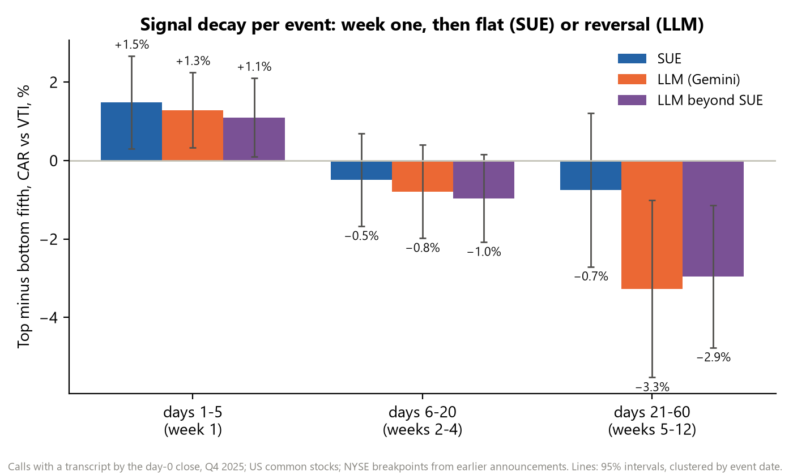
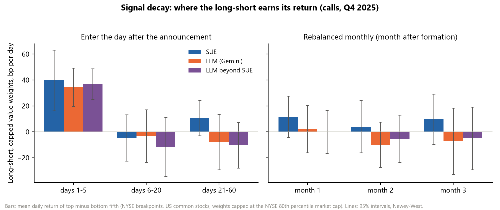
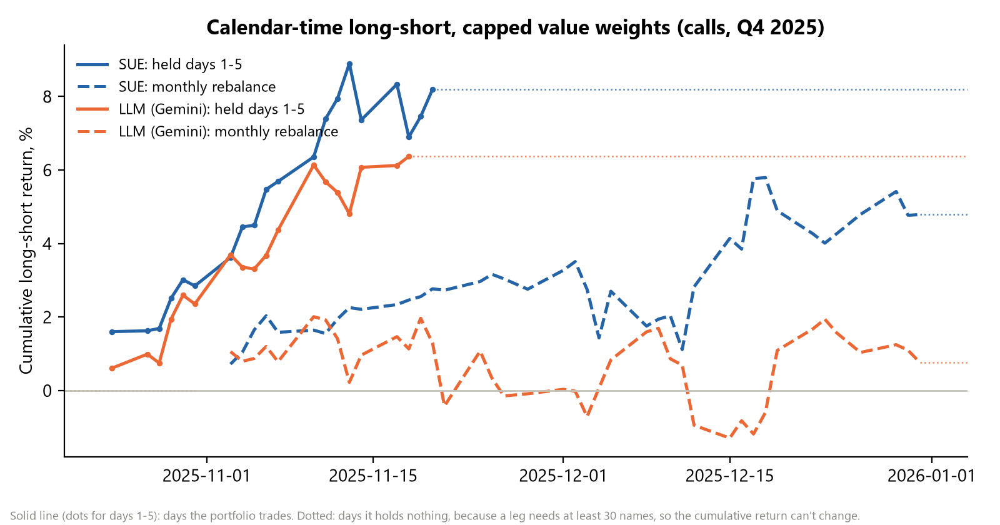
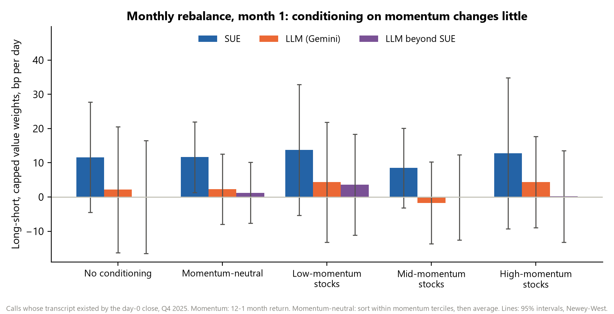
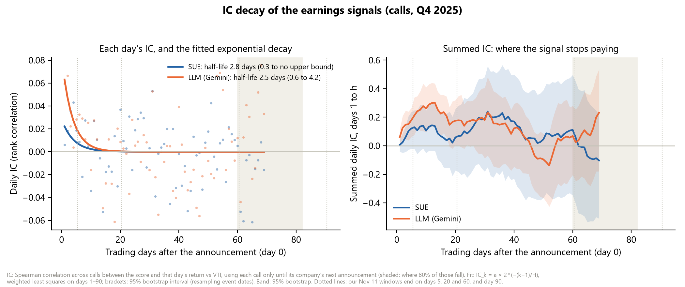
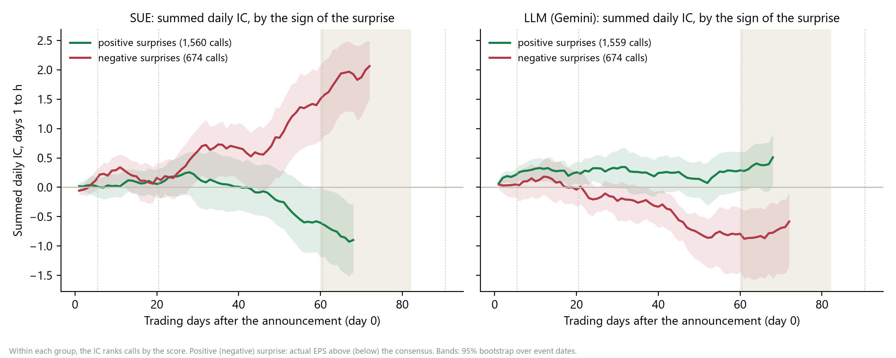
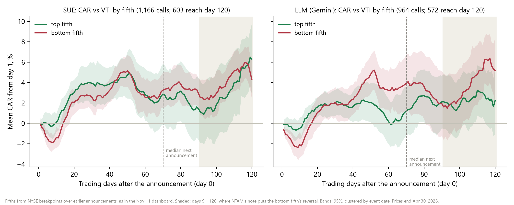
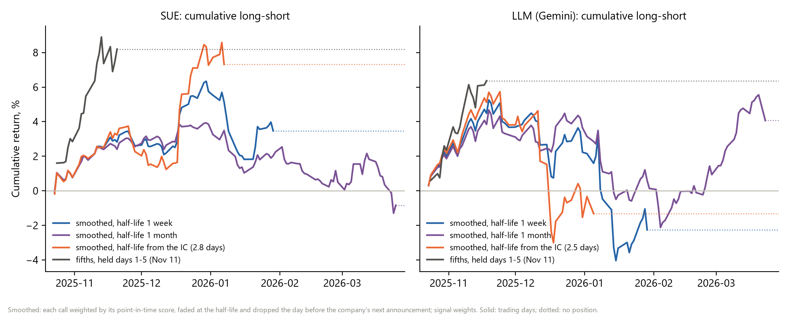

# Factor backtest: the earnings surprise and the LLM score as factors

*Q4 2025 earnings announcements. NTAM project lab (UChicago FINM 36000). First prepared for the Nov 11, 2026 meeting,
to answer the questions of Nov 9 and Nov 10. Updated for the Nov 18 meeting with the decay follow-ups, in sections
10–12. Every number below comes from the backtest output; tables state their units.*

## New on Nov 18

| Question | Answer (Q4 2025) |
|---|---|
| What half-life does the IC decay curve give, and does it match the Nov 11 decay results? | **About 2.5 trading days for the LLM score** (95% interval 0.6 to 4.2), so 75% of its fitted IC comes in the first week, and its IC turns negative after it (days 21–60: −0.067, t −3.1). That matches Nov 11: the return comes in week one, then reverses. **SUE's half-life is about 2.8 days, but it isn't pinned down** (interval 0.3 to no upper bound). Both are far shorter than a 90-day horizon (section 10). |
| A hard expiry at the next announcement? | Built in: each call is dropped the day before its company's next announcement (I/B/E/S dates, known for 99% of calls; median 69 trading days later). With half-lives of a few days it rarely binds. The LLM score also weakly predicts the reaction to that next announcement (IC +0.033, t +1.8); SUE doesn't (section 10). |
| Positive vs. negative surprises? | **The LLM's week-one information is in the beats** (IC +0.091, t +3.3; misses +0.014), **and its reversal is in the misses.** SUE is the other way around: the size of a miss keeps predicting returns for about three months, while the size of a beat stops after about two. The bottom fifth's CAR over days 91–120 is positive for every signal, which would fit a late reversal, but no t-stat exceeds 1.5 (section 11). |
| Alpha-weighted, smoothed portfolios? | **SUE works with signal × capped-cap weights at every half-life,** and the LLM score doesn't at any (t ≤ 1.1). With half-lives of up to a week, the smoothed LLM books earn +15.8 to +30.8 bp a day on the busy reporting days, when the Nov 11 fifths trade (the fifths: +34.6), and −40.6 to +6.5 on the other days. So the LLM's week-one result sits in the busy weeks (section 12). |
| Why is there a straight line at the end of the cumulative chart? | Those are days with no position, so the cumulative return can't move. They're now drawn dotted (section 4). |

## Summary of Nov 11

| Question | Answer (Q4 2025) |
|---|---|
| How fast does the signal decay? | **Fast.** Per event, both signals earn their return in the first week after the announcement: +1.5% for SUE and +1.3% for the LLM score (top minus bottom fifth). After that SUE goes flat, while the LLM long-short **reverses** by weeks 5–12: −3.3% (t −2.8), negative in every busy reporting week. The small dip in weeks 2–4 isn't robust. |
| Can a monthly rebalance capture it? | **No.** At the month-end rebalance the median stock is already 11 trading days past its announcement (10th to 90th percentile: 1 to 17). Month-1 long-shorts are close to zero: +2.1 bp a day for the LLM score (t +0.2), +11.6 for SUE (t +1.4). Months 2 and 3 are also close to zero. |
| Does conditioning on price momentum help? | **Not for the LLM score:** +2.3 bp a day momentum-neutral (t +0.4). For SUE a little: +11.7 bp a day (t +2.2), short of t > 3. |
| Can we add options-implied data? | We have OptionMetrics on WRDS, but it currently ends on 2025-08-29, before the Q4 2025 events, so it isn't in this backtest. It covers 2024 to mid-2025, so it can go on the earlier quarters (section 14). |
| Does anything clear the t > 3 hurdle? | Per event, only parts of the LLM reversal: LLM (Qwen), weeks 2–4 (t −3.4); LLM beyond SUE, weeks 5–12 (t −3.2). In calendar time, 13 of 180 portfolio tests clear it, all week-one portfolios that trade on only 16–22 days. With legs of 10 or more names (instead of 30), 0 do. |
| Main limitation | One quarter of announcements, most of them within four weeks. The shape of the decay is clear. Its size, and whether the reversal is real, need more quarters. |

**Reading the tables.** "bp per day (t)" is the mean daily long-short return in basis points, with its Newey-West t
statistic. "% (t)" is a per-event cumulative abnormal return. "IC (t)" is a rank correlation with its t statistic,
clustered by event date. **Bold** means |t| ≥ 3 (Harvey, Liu and Zhu). Unless a table says otherwise: US common
stocks, NYSE breakpoints, and weights capped at the NYSE 80th percentile of market cap (section 2.4).

**Contents:**

1. What we test
2. Method
3. Signal decay per event
4. Calendar-time portfolios, entering after the announcement
5. Monthly rebalancing
6. Conditioning on price momentum
7. Factor exposure
8. Fama-MacBeth regressions
9. Weighting and concentration
10. IC decay and the half-life (new)
11. Positive and negative surprises (new)
12. Smoothed, signal-weighted portfolios (new)
13. Limitations
14. Next steps
15. Appendix: reproducibility

---

## 1. What we test

| Signal | Definition | Sample |
|---|---|---|
| SUE, all I/B/E/S events | (actual EPS − mean consensus) ÷ the close before the event date. I/B/E/S, last monthly consensus before the release | 3,081 announcements |
| SUE, calls | The same surprise from our pipeline: analyst-level consensus built right before the release | 2,262 calls whose transcript existed by the day-0 close |
| LLM (Gemini) | Gemini 2.5 Flash-Lite's 0–1 prediction of the stock reaction, scoring its own summary of the anonymized call (run through NTAM's OpenRouter key) | the calls |
| LLM (Qwen) | Qwen3-30B, same task, run locally on the university cluster (a check on the Gemini run) | the calls |
| LLM beyond SUE | The part of the LLM score that SUE doesn't explain: the residual from regressing rank(LLM) on rank(SUE) within each formation set | the calls |

Our SUE is what Chiang et al. (2019) call CE, the consensus error: the surprise against analysts' forecasts. The
time-series SUE of Bernard & Thomas (1990), built from the company's own past earnings, is a different measure.

Q4 2025 is after both models' training cutoffs, which limits look-ahead. The three questions are the ones NTAM asked on Nov 10: how fast the signal decays, whether a monthly rebalance captures it, and whether conditioning on price momentum
changes that. The tests follow the protocol NTAM sent the same day.

---

## 2. Method

### 2.1 Data and universe

| Protocol item | CRSP version (NTAM's protocol) | What we use |
|---|---|---|
| Common stocks | shrcd 10/11 | Compustat `tpci` "0" (common) and `fic` "USA" (US-incorporated), the company's primary issue |
| Exchanges | exchcd 1/2/3 (NYSE, AMEX, Nasdaq) | Compustat `exchg` 11/12/14 |
| Daily returns | CRSP daily | Compustat daily (`comp.secd`), Sep 2, 2025 to Apr 30, 2026: total return where a dividend factor exists, else split-adjusted price return. CRSP on WRDS ends Dec 31, 2025, before our holding periods end |
| Delisting returns | Shumway | −30% (NYSE/AMEX) or −55% (Nasdaq) on the first missing day of a security that Compustat deleted for bankruptcy or liquidation. 207 securities qualify, none inside any holding window |
| Market and factors | | VTI. Fama-French 5 factors and momentum, daily, from Ken French's data library |

That gives 4,029 securities. A missing daily return inside a holding period earns VTI's
return.

### 2.2 Sorting

- Quintiles (fifths) of the signal, with breakpoints from NYSE stocks only.
- **No look-ahead:**
    - The event-time portfolios (section 4) take breakpoints from all announcements up to that day. At least 50 NYSE
      announcements are needed, so the first days of the quarter have no portfolio.
    - The monthly portfolios (section 5) take them from that month's announcers, at month-end.
- The LLM scores take only 14–16 distinct values, so ties are broken at random, with a fixed seed.
- **Transcript timing.** We enter at the day-0 close, so a call is only used if its transcript existed by then.
  Otherwise the LLM couldn't have scored it in time. The SUE-on-calls rows use the same calls, so the comparison
  is like for like.

### 2.3 Two ways to hold the portfolio

- **Enter after the announcement (event-time windows).** A stock that announces on day 0 enters at the close of day
  a − 1 and is held through day b. The windows are days 1–5, 6–20 and 21–60, plus 1–20 and 1–60. On each calendar
  day, the portfolio holds every stock whose window covers that day. Day 0 is the event date: the announcement day if
  it came by 16:00 ET, otherwise the next trading day.
- **Monthly rebalance.** At the last trading day of month m, form quintiles from month m's announcers and hold them
  through month m + k (k = 1, 2, 3). "Months 1–3" holds the last three monthly cohorts at once and averages their
  long-shorts (Jegadeesh-Titman). At the rebalance, the median stock is 11 trading days past its announcement.

### 2.4 Returns and weights

```
v_i(t)    = w_i × Π (1 + r_i(s)), s from entry to t−1        buy-and-hold value of position i
R_leg(t)  = Σ_i v_i(t) · r_i(t) / Σ_i v_i(t)                   daily return of a leg
R_LS(t)   = R_long(t) − R_short(t)                             long-short, zero cost
w_i       = ME_i                                               value-weighted (VW)
          = min(ME_i, NYSE 80th-percentile ME at entry)        capped VW (Jensen, Kelly and Pedersen 2023)
          = 1                                                  equal-weighted (EW)
N_eff     = (Σ_i v_i)² / Σ_i v_i²                              effective number of names in a leg
```

ME is market cap at the close before entry. A leg trades only on days it holds at least 30 names. Each table also
shows the result with 10 names allowed, because with one quarter many days are thin (section 4).

### 2.5 Price momentum

```
MOM_i(m) = TRI_i(end of month m−1) / TRI_i(end of month m−12) − 1      12-1 momentum (skips month m)
```

TRI is the total-return index, from Compustat prices for Oct 2024 to Nov 2025. It covers
99% of events.

- **Momentum-neutral:** NYSE terciles of momentum, then signal quintiles within each tercile. The three long-shorts
  are averaged.
- **By tercile:** the long-short inside low-, mid- and high-momentum stocks.

### 2.6 Statistics

- **Per event:** `CAR_i = Σ (r_i(t) − r_VTI(t))` over the window, winsorized at 1%/99%. Spread = mean of the top fifth
  − mean of the bottom fifth, with the t statistic clustered by event date.
- **Calendar time:** the mean of `R_LS(t)` over trading days, with a Newey-West t (5 lags). Sharpe = √252 × mean / sd.
- **Alpha:** `R_LS(t) = α + β · [MKT−RF, SMB, HML, RMW, CMA, UMD](t) + ε(t)`, Newey-West (5 lags).
- **Fama-MacBeth:** each day, OLS across the stocks in the window of `r_i(t)` on the standardized ranks of the signals
  (and of momentum, where included) and standardized log market cap. Mean slope over days, with a Newey-West t.
- **Multiple testing:** |t| ≥ 3 is marked in bold.

---

## 3. Signal decay per event



Each event's cumulative abnormal return vs VTI over the window, top fifth minus bottom fifth, in % (t clustered by
event date). The positions are the same as the calendar-time portfolios in section 4, and every event counts once.

| Per event, % (t) | Days 1–5 (week 1) | Days 6–20 (weeks 2–4) | Days 21–60 (weeks 5–12) |
|---|---|---|---|
| SUE, all I/B/E/S events | +1.20% (+2.5) | +0.36% (+0.5) | −0.55% (−0.6) |
| SUE, calls | +1.48% (+2.5) | −0.49% (−0.8) | −0.75% (−0.8) |
| LLM (Gemini) | +1.29% (+2.6) | −0.79% (−1.3) | −3.27% (−2.8) |
| LLM (Qwen) | +0.69% (+1.7) | **−1.78% (−3.4)** | −3.66% (−2.3) |
| LLM beyond SUE | +1.10% (+2.2) | −0.96% (−1.7) | **−2.95% (−3.2)** |

- **Week one is positive for every signal:** from +0.7% (Qwen) to
  +1.5% (SUE) on the calls, and +1.2% for SUE on all events.
- **SUE then goes flat.** That's consistent with Martineau (2022): little post-announcement drift remains.
- **The LLM long-short reverses by weeks 5–12,** and so does the part of the LLM score that SUE doesn't explain
  (−2.9%, t
  −3.2). The small dip in weeks 2–4 isn't
  robust.

**Is one reporting week driving it?** No. Most Q4 announcements fall in four reporting weeks. Below is the Gemini
long-short within each of them (at least 10 events per leg), per event, in %:

| Reporting week of | Events, long / short | Week 1 | Weeks 2–4 | Weeks 5–12 | Weeks 5–12, all other weeks |
|---|---|---|---|---|---|
| 2025-10-20 | 53 / 67 | +1.61% | −0.11% | −3.89% | −3.03% |
| 2025-10-27 | 139 / 124 | +1.05% | +0.11% | −2.69% | −3.74% |
| 2025-11-03 | 187 / 189 | +2.58% | −0.87% | −3.55% | −3.06% |
| 2025-11-10 | 36 / 73 | −3.04% | +1.22% | −9.22% | −3.21% |

- **The weeks 5–12 reversal is negative in 4 of 4 weeks.** Dropping
  any one week leaves −3.0% to
  −3.7%. It isn't one week.
- **But all these windows fall in December to February,** so a market move in those months can't be ruled out with
  one quarter.
- **The week-one gain leans on the busiest week.** Without the week of 2025-11-03 it falls to
  +0.45%, which is worth knowing before reading much into its size.

---

## 4. Calendar-time portfolios, entering after the announcement



Mean daily long-short return in bp per day (Newey-West t). Left panel: this section. Right panel: section 5.

| bp per day (t) | Days 1–5 | Days 6–20 | Days 21–60 | Days 1–20 | Days 1–60 | Days 1–5, legs ≥ 10 names |
|---|---|---|---|---|---|---|
| SUE, all I/B/E/S events | +14.3 (+0.8) | −2.6 (−0.2) | +13.7 (+1.8) | +11.5 (+0.9) | +15.0 (+2.3) | +19.9 (+0.6) |
| SUE, calls | **+39.7 (+3.3)** | −4.6 (−0.5) | +10.7 (+1.5) | +18.0 (+1.5) | +13.9 (+2.2) | +6.5 (+0.3) |
| LLM (Gemini) | **+34.6 (+4.6)** | −3.2 (−0.3) | −8.1 (−0.7) | +8.7 (+0.7) | −0.8 (−0.1) | +10.3 (+0.5) |
| LLM (Qwen) | **+26.4 (+3.5)** | −15.9 (−1.9) | −2.7 (−0.2) | −2.0 (−0.2) | −0.1 (−0.0) | −0.5 (−0.0) |
| LLM beyond SUE | **+36.9 (+6.1)** | −11.5 (−1.0) | −10.4 (−1.2) | +1.5 (+0.1) | −3.4 (−0.5) | +16.7 (+1.0) |

- **Week one is the strong window,** with the same shape as section 3. The LLM earns +34.6 bp a
  day (t +4.6) over days 1–5.
- **But one quarter gives few trading days.** Announcements cluster, so the week-one portfolio trades on only
  16–22 days. If legs as small as 10 names are allowed, thin and noisy days enter, and the LLM's week-one
  return falls to +10.3 bp a day (t +0.5). The direction is clear, but the size
  isn't pinned down by one quarter.
- **Why the per-event and calendar-time numbers differ:** in section 3 every *event* counts once, here every *day*
  counts once.



**A question from the Nov 11 meeting: why the straight line at the end?** After the last Q4 announcements no stock is inside its
window, so the portfolio holds nothing and its cumulative return can't move. The chart now draws those days dotted,
with dots on the days the week-one portfolios trade.

---

## 5. Monthly rebalancing

Form at each month-end from that month's announcers, and hold through month 1, 2 or 3. bp per day (t).

| bp per day (t) | Month 1 | Month 2 | Month 3 | Months 1–3 (overlapping) | Month 1, legs ≥ 10 names |
|---|---|---|---|---|---|
| SUE, all I/B/E/S events | +0.9 (+0.0) | −10.3 (−1.0) | +9.9 (+0.8) | +3.7 (+0.4) | +0.9 (+0.0) |
| SUE, calls | +11.6 (+1.4) | +4.0 (+0.4) | +9.7 (+1.0) | +10.1 (+1.8) | −22.0 (−1.0) |
| LLM (Gemini) | +2.1 (+0.2) | −9.9 (−1.1) | −7.3 (−0.6) | −4.3 (−0.6) | −12.8 (−0.7) |
| LLM (Qwen) | +2.8 (+0.4) | −20.8 (−1.5) | −5.3 (−0.5) | −5.6 (−0.7) | −16.8 (−1.1) |
| LLM beyond SUE | +0.0 (+0.0) | −5.4 (−0.6) | −5.1 (−0.4) | −3.0 (−0.4) | −14.2 (−1.2) |

By weighting scheme, month 1 and days 1–5:

| bp per day (t) | Month 1, capped VW | Month 1, VW | Month 1, EW | Days 1–5, capped VW | Days 1–5, VW | Days 1–5, EW |
|---|---|---|---|---|---|---|
| SUE, all I/B/E/S events | +0.9 (+0.0) | +51.4 (+1.7) | −6.4 (−0.5) | +14.3 (+0.8) | +14.8 (+0.8) | +18.4 (+2.3) |
| SUE, calls | +11.6 (+1.4) | +21.7 (+1.5) | +2.6 (+0.4) | **+39.7 (+3.3)** | **+45.9 (+3.1)** | **+25.3 (+4.2)** |
| LLM (Gemini) | +2.1 (+0.2) | +9.4 (+0.5) | +7.5 (+1.0) | **+34.6 (+4.6)** | +24.5 (+1.9) | **+43.4 (+5.0)** |
| LLM (Qwen) | +2.8 (+0.4) | +12.2 (+0.8) | +3.0 (+0.3) | **+26.4 (+3.5)** | **+30.9 (+3.4)** | +16.7 (+1.6) |
| LLM beyond SUE | +0.0 (+0.0) | +13.7 (+0.7) | +5.9 (+0.8) | **+36.9 (+6.1)** | +30.7 (+2.6) | **+34.0 (+4.7)** |

- **At the rebalance, the median stock is already 11 trading days past its announcement,** so the week-one move
  is mostly over. Month-1 spreads are close to zero for every signal, and so are months 2 and 3.
- **The plain-VW SUE number (+51.4 bp a day) is one stock,** Micron (section 9). Capped VW and EW put
  it near zero.

---

## 6. Conditioning on price momentum



Month 1 of the monthly rebalance, capped VW, bp per day (t).

| Month 1, capped VW, bp per day (t) | No conditioning | Momentum-neutral | Low momentum | Mid momentum | High momentum | Momentum-neutral, legs ≥ 10 |
|---|---|---|---|---|---|---|
| SUE, all I/B/E/S events | +0.9 (+0.0) | +9.1 (+1.5) | +6.2 (+0.6) | +9.1 (+1.1) | +12.0 (+1.0) | +5.0 (+0.3) |
| SUE, calls | +11.6 (+1.4) | +11.7 (+2.2) | +13.7 (+1.4) | +8.5 (+1.4) | +12.8 (+1.1) | +9.7 (+0.6) |
| LLM (Gemini) | +2.1 (+0.2) | +2.3 (+0.4) | +4.3 (+0.5) | −1.7 (−0.3) | +4.4 (+0.6) | +2.3 (+0.4) |
| LLM (Qwen) | +2.8 (+0.4) | +3.5 (+0.8) | +5.9 (+0.7) | −2.0 (−0.3) | +6.6 (+0.7) | −10.9 (−0.4) |
| LLM beyond SUE | +0.0 (+0.0) | +1.2 (+0.3) | +3.6 (+0.5) | −0.1 (−0.0) | +0.2 (+0.0) | +1.2 (+0.3) |

- **The LLM score stays near zero** with or without momentum conditioning, in every momentum tercile.
- **SUE is a little positive across terciles** (momentum-neutral +11.7 bp a day, t
  +2.2), but short of t > 3.
- **Momentum isn't hiding a monthly signal.**

---

## 7. Factor exposure

Alphas on Fama-French 5 plus momentum (UMD), in bp per day (Newey-West t), with the momentum loading.

| Alpha, bp per day (t); momentum loading | Days 1–5 | Days 21–60 | Month 1 | Months 1–3 |
|---|---|---|---|---|
| SUE, all I/B/E/S events | +5.6 (+0.6); β mom +0.61 | +9.8 (+1.2); β mom +0.01 | +3.7 (+0.2); β mom −0.11 | +1.8 (+0.2); β mom +0.15 |
| SUE, calls | **+33.0 (+4.7); β mom +0.20** | +8.1 (+1.7); β mom −0.07 | +5.4 (+1.1); β mom +0.24 | +6.3 (+1.7); β mom +0.05 |
| LLM (Gemini) | +15.5 (+1.6); β mom +0.50 | +1.4 (+0.2); β mom +0.00 | +4.6 (+0.7); β mom +0.34 | +6.6 (+1.4); β mom +0.07 |
| LLM (Qwen) | **+20.3 (+3.2); β mom +0.42** | +10.4 (+1.0); β mom −0.18 | +1.9 (+0.4); β mom +0.34 | +4.5 (+0.9); β mom −0.02 |
| LLM beyond SUE | +23.2 (+1.7); β mom +0.33 | −0.7 (−0.1); β mom +0.26 | −0.0 (−0.0); β mom +0.35 | +7.0 (+1.6); β mom +0.09 |

The week-one portfolios load positively on momentum: stocks with good news have often been rising already. Their
alphas stay positive after the six factors, on the same 16–22 trading days.

---

## 8. Fama-MacBeth regressions

Daily cross-sections over the stocks in each event window. Mean slope, in bp per day per standard deviation of the
signal's rank (Newey-West t over days).

| Sample: model | Slope on | Days 1–5 | Days 6–20 | Days 21–60 |
|---|---|---|---|---|
| All I/B/E/S events: SUE + log size | SUE | +10.4 (+1.9) | +2.2 (+0.7) | +0.5 (+0.3) |
| All I/B/E/S events: SUE + momentum + log size | SUE | +10.9 (+1.9) | +2.0 (+0.6) | +1.5 (+1.1) |
| All I/B/E/S events: SUE + momentum + log size | momentum | −2.1 (−0.4) | +5.0 (+1.2) | −1.3 (−0.3) |
| Calls: SUE + log size | SUE | +7.9 (+1.6) | −1.5 (−0.4) | +1.9 (+1.2) |
| Calls: LLM + log size | LLM | +4.1 (+0.9) | −1.6 (−0.4) | +2.1 (+0.6) |
| Calls: SUE + LLM + log size | SUE | +8.1 (+1.6) | −1.0 (−0.3) | +1.3 (+0.9) |
| Calls: SUE + LLM + log size | LLM | +1.9 (+0.4) | −1.3 (−0.3) | +1.8 (+0.5) |
| Calls: SUE + LLM + momentum + log size | SUE | +6.4 (+1.4) | +0.1 (+0.0) | +1.3 (+0.8) |
| Calls: SUE + LLM + momentum + log size | LLM | +2.8 (+0.6) | −2.8 (−0.6) | −0.7 (−0.2) |
| Calls: SUE + LLM + momentum + log size | momentum | +3.8 (+0.7) | +3.9 (+0.7) | +4.0 (+1.0) |

- **No slope clears t = 2.** The week-one SUE slope comes closest.
- **With SUE in the model,** the LLM's slope is small and insignificant.
- **These daily cross-sections are often thin,** like the portfolios in section 4. The per-event sorts (section 3)
  still show the part of the LLM score that SUE doesn't explain earning
  +1.1% in week one (t
  +2.2), and then reversing.
- **All of this is about returns after day 0.** The LLM's explanatory power for the day-0 reaction itself (R² of about
  0.11 with the surprise, vs. 0.047 for the surprise alone) is a separate result.

---

## 9. Weighting and concentration

With one quarter of announcers, plain value weights hand most of a leg to one or two mega-caps:

- In the October cohort's SUE long leg, **Alphabet (GOOGL) is 34%** of the weight.
- In the December cohort's, **Micron (MU) is 84%**. Micron rose 45% in January, which is most of the plain-VW SUE
  result in section 5.

Capping weights at the NYSE 80th percentile (Jensen, Kelly and Pedersen 2023) removes that. Without the cap, the
month-1 SUE long leg's 264 names are worth about 9 equal positions;
with it, about 64. Equal weights are shown only as a check, because of the microcap
problem Hou, Xue and Zhang document.

| Signal | Holding | Weights | Names, long / short | Effective names, long / short | Largest weight, long / short |
|---|---|---|---|---|---|
| SUE, all I/B/E/S events | month 1 | VW | 264 / 241 | 9 / 27 | 45% / 18% |
| SUE, all I/B/E/S events | month 1 | capped VW | 264 / 241 | 64 / 56 | 10% / 8% |
| SUE, all I/B/E/S events | month 1 | EW | 264 / 241 | 260 / 236 | 1% / 2% |
| SUE, all I/B/E/S events | days 1–5 | VW | 181 / 177 | 18 / 21 | 24% / 22% |
| SUE, all I/B/E/S events | days 1–5 | capped VW | 181 / 177 | 51 / 49 | 6% / 6% |
| SUE, all I/B/E/S events | days 1–5 | EW | 181 / 177 | 180 / 176 | 1% / 1% |
| SUE, calls | month 1 | VW | 252 / 235 | 11 / 27 | 26% / 15% |
| SUE, calls | month 1 | capped VW | 252 / 235 | 74 / 69 | 3% / 3% |
| SUE, calls | month 1 | EW | 252 / 235 | 250 / 230 | 1% / 1% |
| SUE, calls | days 1–5 | VW | 126 / 135 | 13 / 19 | 27% / 23% |
| SUE, calls | days 1–5 | capped VW | 126 / 135 | 40 / 45 | 7% / 7% |
| SUE, calls | days 1–5 | EW | 126 / 135 | 126 / 135 | 1% / 1% |
| LLM (Gemini) | month 1 | VW | 206 / 213 | 6 / 11 | 44% / 24% |
| LLM (Gemini) | month 1 | capped VW | 206 / 213 | 113 / 77 | 1% / 2% |
| LLM (Gemini) | month 1 | EW | 206 / 213 | 198 / 211 | 1% / 1% |
| LLM (Gemini) | days 1–5 | VW | 112 / 119 | 9 / 15 | 32% / 19% |
| LLM (Gemini) | days 1–5 | capped VW | 112 / 119 | 63 / 44 | 5% / 6% |
| LLM (Gemini) | days 1–5 | EW | 112 / 119 | 112 / 119 | 1% / 1% |

---

<div style="page-break-before: always"></div>

## 10. IC decay and the half-life (new)

*The question: estimate the half-life from the IC decay curve, check that it matches the Nov 11 decay results, and
use a hard expiry at the next announcement instead of a fixed holding period.*



```
AR_i(k) = r_i(k) − r_VTI(k)     call i's abnormal return on trading day k after day 0
IC_k    = Spearman correlation, across calls, of the score s_i and AR_i(k); standard
          error clustered by event date. Each call is used only until the day before
          its company's next announcement (I/B/E/S dates).
fit       IC_k = a × 2^(−(k−1)/H), k = 1 … 90, weighted least squares (weights 1/SE_k²)
H       = the half-life in trading days. 95% interval: resample event dates 500 times,
          recompute every IC_k and refit.
S_k     = IC_1 + … + IC_k, the summed IC. It rises while the signal pays, flattens
          when it stops, and falls if the signal reverses.
```

| Signal | Calls | Fitted IC on day 1 | Half-life, trading days (95% interval) | Share of the fitted IC in days 1–5 | Summed IC by day 5 / 20 / 60 |
|---|---|---|---|---|---|
| SUE, all I/B/E/S events | 3,081 | +0.022 | 3.2 (0.2 to 40.6) | 67% | +0.10 / +0.17 / +0.16 |
| SUE, calls | 2,262 | +0.022 | 2.8 (0.3 to no upper bound) | 71% | +0.12 / +0.06 / +0.11 |
| LLM (Gemini) | 2,261 | +0.063 | 2.5 (0.6 to 4.2) | 75% | +0.18 / +0.18 / +0.07 |
| LLM (Qwen) | 2,262 | +0.062 | 1.9 (0.7 to 134.0) | 83% | +0.17 / +0.15 / +0.14 |
| LLM beyond SUE | 2,261 | +0.058 | 2.8 (0.8 to 4.5) | 71% | +0.17 / +0.17 / +0.05 |

By window, the same IC and the IC at the next announcement:

| IC (t) | Days 1–5 | Days 6–20 | Days 21–60 | At the next announcement, days −1 to +1 |
|---|---|---|---|---|
| SUE, all I/B/E/S events | +0.056 (+2.5) | +0.034 (+1.8) | −0.006 (−0.3) | −0.005 (−0.3) |
| SUE, calls | +0.057 (+2.2) | +0.004 (+0.2) | −0.017 (−0.7) | −0.015 (−0.6) |
| LLM (Gemini) | +0.074 (+3.0) | −0.043 (−2.2) | **−0.067 (−3.1)** | +0.033 (+1.8) |
| LLM (Qwen) | +0.056 (+2.8) | −0.047 (−2.0) | −0.069 (−2.3) | +0.038 (+2.0) |
| LLM beyond SUE | **+0.070 (+3.0)** | −0.045 (−2.2) | **−0.064 (−3.1)** | +0.032 (+1.8) |

- **The LLM score's half-life is about 2.5 trading days** (95% interval
  0.6 to 4.2; Qwen 1.9). 75%
  of its fitted IC comes in days 1–5, and a stock's weight would fall below 1% of its start after about
  17 days. **That matches Nov 11** (section 3): the LLM's return comes in week one.
- **After week one the LLM's IC turns negative:** −0.043 (t −2.2) over
  days 6–20 and −0.067 (t −3.1) over days 21–60. That is the Nov 11
  reversal, and by ranks it already shows in weeks 2–4. The summed daily IC shows it later: it falls from
  +0.18 at day 20 to −0.14 at day 52. The summed IC counts every day's ranking
  equally, while a window's IC is driven by the days with the biggest moves.
- **SUE's half-life is about 2.8 days on the calls and 3.2 on all
  events, but it isn't pinned down:** its daily IC is small (fitted +0.022 on day 1, against
  +0.063 for the LLM), so the intervals run to 41 days or have no upper
  bound. By window, SUE's IC is positive in week one (t +2.2 to +2.5) and near zero from day 21,
  which is also its Nov 11 shape.
- **A 90-day horizon is much longer than either signal lasts in Q4 2025.** The hard expiry is now part of every
  result here and in section 12: a call is dropped the day before its company's next announcement, which is known for
  99% of calls and comes a median 69 trading days later (10th to 90th percentile: 59 to
  81). With half-lives of 2–3 days, it rarely binds.
- **The LLM score also weakly predicts the reaction to the next announcement:** IC +0.033 (t +1.8)
  for Gemini and +0.038 (t +2.0) for Qwen, over days −1 to +1 around it. SUE doesn't
  (−0.015, t −0.6). Below t = 3, but it bears on whether the score predicts next
  quarter's surprise.

---

<div style="page-break-before: always"></div>

## 11. Positive and negative surprises (new)

*The question: treat positive and negative surprises separately, shortening the negative side's holding or fading
it after day 90. Test: the IC by sign and horizon. The hypothesis: the bottom quintile reverses over days 90–120.*



Within each group the IC ranks calls by the score, so it asks whether the size of a beat (or the LLM's read of it)
predicts returns among beats, and the same for misses. Returns run until the next announcement, as in section 10.

| IC (t) | Calls | Days 1–5 | Days 6–20 | Days 21–60 | Summed IC by day 60 (95% band) |
|---|---|---|---|---|---|
| SUE, all I/B/E/S events: beats | 1,994 | +0.053 (+1.7) | **+0.087 (+3.8)** | −0.034 (−1.2) | −0.90 (−1.54 to −0.29) |
| SUE, all I/B/E/S events: misses | 921 | −0.009 (−0.3) | +0.000 (+0.0) | +0.092 (+2.4) | +1.81 (+1.12 to +2.64) |
| SUE, calls: beats | 1,560 | +0.036 (+1.1) | **+0.074 (+3.6)** | −0.036 (−1.0) | −0.60 (−1.19 to +0.01) |
| SUE, calls: misses | 674 | +0.005 (+0.1) | −0.014 (−0.4) | +0.083 (+1.5) | +1.50 (+0.79 to +2.08) |
| LLM (Gemini): beats | 1,559 | **+0.091 (+3.3)** | −0.037 (−1.5) | −0.056 (−1.8) | +0.29 (−0.06 to +0.61) |
| LLM (Gemini): misses | 674 | +0.014 (+0.4) | −0.045 (−1.4) | **−0.100 (−3.4)** | −0.79 (−1.44 to −0.35) |
| LLM (Qwen): beats | 1,560 | +0.069 (+2.9) | −0.038 (−1.3) | −0.061 (−1.8) | +0.28 (−0.13 to +0.73) |
| LLM (Qwen): misses | 674 | −0.003 (−0.1) | −0.059 (−1.5) | −0.100 (−3.0) | −0.66 (−1.17 to −0.17) |
| LLM beyond SUE: beats | 1,559 | **+0.092 (+3.6)** | −0.045 (−1.9) | −0.045 (−1.5) | +0.36 (−0.02 to +0.70) |
| LLM beyond SUE: misses | 674 | +0.013 (+0.3) | −0.045 (−1.5) | **−0.114 (−4.0)** | −0.91 (−1.52 to −0.46) |

- **The LLM's week-one information is in the beats:** within positive surprises its days 1–5 IC is
  +0.091 (t +3.3). Within misses it is +0.014 (t +0.4).
- **The LLM's reversal is in the misses:** within negative surprises its IC over days 21–60 is
  −0.100 (t −3.4), and the summed IC falls to −0.79 by day 60 (95% band
  −1.44 to −0.35). Within beats it stays positive (+0.29). Among misses, the
  calls the LLM read more kindly did worse in the second and third months.
- **SUE is the other way around.** Within beats, the size of the beat predicts weeks 2–4 (IC
  +0.087, t +3.8 on all events), then fades and turns negative after about two months
  (−0.90 by day 60). Within misses, the summed IC keeps rising to +1.81 by day 60
  (band +1.12 to +2.64): bigger misses keep drifting down for about three months.
- **So the two sides do behave differently, but differently for the two signals.** For the LLM
  score, the negative side is the one to shorten (after about two weeks). For SUE, it is the side that lasts.



The top and bottom fifths' mean CAR vs VTI out to day 120 (fifths as in section 3, all days, no expiry). Over days
91–120 alone:

| CAR vs VTI over days 91–120, % (t) | Top fifth | Bottom fifth | Calls that reach day 120, top / bottom |
|---|---|---|---|
| SUE, all I/B/E/S events | +0.62% (+1.0) | +0.88% (+1.5) | 385 / 396 |
| SUE, calls | +1.11% (+1.7) | +0.39% (+0.6) | 290 / 313 |
| LLM (Gemini) | −1.39% (−1.7) | +1.35% (+1.2) | 291 / 281 |
| LLM (Qwen) | +0.57% (+0.8) | +0.54% (+0.6) | 260 / 280 |
| LLM beyond SUE | −1.34% (−1.8) | +1.35% (+1.2) | 289 / 273 |

- **The bottom fifth's CAR over days 91–120 is positive for every signal** (+0.4%
  to +1.4%), which would fit a late reversal, **but none is significant** (t ≤
  1.5). Only calls up to early November reach day 120, about 273–396
  per fifth.
- **Both fifths drift up against VTI** over the quarter. Those are equal-weighted averages of mostly smaller companies
  against a cap-weighted index, so the signal is the gap between the lines, not their level.

---

<div style="page-break-before: always"></div>

## 12. Smoothed, signal-weighted portfolios (new)

*The suggestion: because these signals are sparse at the company level, decile or quintile spreads have a limited
cross-section, so use pure univariate factor-mimicking (alpha-weighted) long-shorts, and smooth the company signals
exponentially, with half-lives calibrated on the holding periods (a day, a month and a quarter) and a hard expiry at
the next announcement.*

```
s_i     = 2 × (the call's percentile among the NYSE announcements so far) − 1
          in [−1, 1], with no look-ahead
w_i(t)  = s_i × 2^(−(age − 1)/H) for age = 1 … the day before the next announcement,
          else 0; times min(ME_i, NYSE 80th-percentile ME) for "signal × capped cap"
R_LS(t) = Σ w_i⁺ r_i / Σ w_i⁺ − Σ |w_i⁻| r_i / Σ |w_i⁻|
          long leg w > 0, short leg w < 0, $1 each, rebalanced daily
H       = 1 day, 1 week (5), 1 month (21) or 1 quarter (63) trading days, or the IC
          half-life of section 10
```

A leg trades on days it holds at least 30 names whose decay factor is still at least 1%. Every call with a score is
in the book (no fifths), weighted by how far its score sits from the NYSE median.

| bp per day (t): signal weights / signal × capped cap | SUE, all I/B/E/S events | SUE, calls | LLM (Gemini) | LLM (Qwen) | LLM beyond SUE |
|---|---|---|---|---|---|
| 1 day | +20.7 (+1.3) / **+69.1 (+3.9)** | −12.5 (−0.6) / **+38.6 (+3.8)** | −2.8 (−0.1) / +4.6 (+0.3) | −5.0 (−0.2) / +10.4 (+0.7) | −4.6 (−0.2) / −0.1 (−0.0) |
| 1 week (5 days) | +8.4 (+1.2) / **+19.7 (+3.1)** | +5.2 (+0.7) / +20.0 (+2.8) | −3.1 (−0.3) / +4.8 (+0.5) | −14.1 (−1.4) / −2.0 (−0.2) | −4.2 (−0.4) / +3.0 (+0.3) |
| 1 month (21 days) | −0.4 (−0.1) / +10.5 (+3.0) | −0.7 (−0.2) / +9.0 (+2.8) | +4.0 (+0.7) / +9.5 (+1.0) | +1.2 (+0.2) / +7.1 (+0.7) | +4.0 (+0.7) / +8.6 (+1.0) |
| 1 quarter (63 days) | −0.4 (−0.1) / +10.1 (+2.7) | −0.6 (−0.1) / +8.4 (+2.8) | +3.8 (+0.7) / +9.3 (+1.1) | +1.8 (+0.3) / +6.9 (+0.7) | +3.8 (+0.7) / +8.5 (+1.0) |
| From the IC (section 10) | +9.7 (+1.2) / +26.4 (+2.7) | +13.8 (+1.4) / **+39.5 (+3.4)** | −2.3 (−0.2) / +11.2 (+0.8) | −14.0 (−0.8) / +13.1 (+0.8) | +1.3 (+0.1) / +15.7 (+1.1) |
| Nov 11 fifths, held days 1–5, capped VW | +14.3 (+0.8) | **+39.7 (+3.3)** | **+34.6 (+4.6)** | **+26.4 (+3.5)** | **+36.9 (+6.1)** |



The same books on the days the Nov 11 fifths (days 1–5) trade, and on the other days:

| Smoothed book | Half-life | Weights | bp per day on the days the Nov 11 fifths trade | bp per day on the other days |
|---|---|---|---|---|
| SUE, calls | 1 day | signal | +27.2 (20 days) | −78.6 (12 days) |
| SUE, calls | 1 day | signal × capped cap | +29.4 (20 days) | +54.1 (12 days) |
| SUE, calls | 1 week | signal | +14.6 (20 days) | +1.2 (47 days) |
| SUE, calls | 1 week | signal × capped cap | +18.5 (20 days) | +20.7 (47 days) |
| SUE, calls | from the IC (2.8 days) | signal | +16.9 (20 days) | +11.8 (32 days) |
| SUE, calls | from the IC (2.8 days) | signal × capped cap | +21.0 (20 days) | +51.0 (32 days) |
| SUE, calls | Nov 11 fifths, days 1–5 | capped VW | +39.7 (20 days) | no position |
| LLM (Gemini) | 1 day | signal | +30.8 (18 days) | −40.6 (16 days) |
| LLM (Gemini) | 1 day | signal × capped cap | +27.3 (18 days) | −21.0 (16 days) |
| LLM (Gemini) | 1 week | signal | +22.8 (18 days) | −12.7 (49 days) |
| LLM (Gemini) | 1 week | signal × capped cap | +15.8 (18 days) | +0.7 (49 days) |
| LLM (Gemini) | from the IC (2.5 days) | signal | +26.2 (18 days) | −18.3 (32 days) |
| LLM (Gemini) | from the IC (2.5 days) | signal × capped cap | +19.6 (18 days) | +6.5 (32 days) |
| LLM (Gemini) | Nov 11 fifths, days 1–5 | capped VW | +34.6 (18 days) | no position |

Book sizes and turnover, signal weights:

| Signal weights | Half-life | Days traded | Names, long / short | Effective names, long / short | Daily turnover per leg |
|---|---|---|---|---|---|
| SUE, calls | 1 day | 32 | 231 / 224 | 83 / 82 | 40% |
| SUE, calls | 1 week | 67 | 561 / 547 | 243 / 245 | 7% |
| SUE, calls | 1 month | 105 | 732 / 711 | 536 / 541 | 5% |
| SUE, calls | 1 quarter | 105 | 732 / 711 | 574 / 573 | 5% |
| SUE, calls | from the IC (2.8 days) | 52 | 403 / 392 | 156 / 153 | 15% |
| LLM (Gemini) | 1 day | 34 | 202 / 230 | 73 / 79 | 39% |
| LLM (Gemini) | 1 week | 67 | 519 / 590 | 230 / 242 | 7% |
| LLM (Gemini) | 1 month | 103 | 687 / 783 | 499 / 548 | 5% |
| LLM (Gemini) | 1 quarter | 103 | 687 / 783 | 526 / 590 | 5% |
| LLM (Gemini) | from the IC (2.5 days) | 50 | 347 / 393 | 134 / 142 | 17% |

- **For the LLM scores, no smoothed book is significant** (t from −1.4 to +1.1),
  whatever the half-life or the weights.
- **Why the Nov 11 fifths looked better:** on the 18 days the LLM fifths trade, the busy
  reporting weeks, the smoothed LLM book with a one-week half-life earns +22.8 bp a day,
  close to the fifths' +34.6. On its other 49 days it earns
  −12.7. The fifths only trade the busy weeks, so their result leans on those weeks, as the
  reporting-week table in section 3 also showed.
- **For SUE, signal × capped-cap weights work at every half-life:** +8.4 to
  +69.1 bp a day (t 2.7 to 3.9). Pure signal weights give
  −12.5 to +20.7, none significant (|t| ≤ 1.4).
  SUE's drift this quarter is in the larger companies, as in the large-cap results of Nov 4.
- **Smoothing does fix the sparsity:** with half-lives of a week or more, the books trade on
  67–108 days instead of 16–22, with
  93–789 effective names a leg. For the LLM score,
  the extra days add no return.
- **Turnover:** with a one-day half-life, about 39% of each leg
  trades every day; with a week, 7%; with a month or a quarter,
  6%. No trading costs are deducted.
- **The "from the IC" rows are in-sample:** their half-life is fitted on the same quarter. The four fixed half-lives
  were chosen in advance. 4 of the 50 smoothed books clear t = 3, all of them SUE with capped-cap weights.

---

## 13. Limitations

- **One quarter.** Q4 2025 has 59 event dates, with 86% of events in four weeks. The holding periods overlap in
  calendar time, so they share the same market moves.
- **Thin days.** The calendar-time results depend on the minimum leg size: 30 names (headline) vs. 10.
- **The LLM's week-one result leans on the busy reporting weeks** (sections 3 and 12).
- **The half-lives and the sign split rest on one quarter.** Their intervals are wide, and SUE's half-life has no upper
  bound. The "from the IC" smoothed books use an in-sample half-life.
- **Compustat, not CRSP.** We use Compustat's equivalents of the CRSP filters, and Compustat delisting reasons in
  place of CRSP delisting returns.
- **Gross returns.** No trading costs, borrow fees or market impact. Turnover is reported for the smoothed books
  (section 12); costs belong to the long-only stage.
- **The LLM inputs.** The models read anonymized transcripts after their training cutoffs. Anonymization is
  incomplete for some calls.

---

## 14. Next steps

- **More quarters (2025).** Every result above needs them. Sean has scored all four quarters of 2025 with Qwen, and
  Austin is adding Gemini scores for Q1–Q3 (about $5 a quarter). With the prices and I/B/E/S for those quarters,
  everything here can be rerun; the WRDS data costs nothing.
- **The LLM score next to CE:** Austin is building the time-series SUE, so we can test whether the LLM score still
  predicts returns at 1, 3 and 6 months given CE (our SUE), the time-series SUE and the announcement CAR.
- **The other follow-ups for the factor work:** show it isn't momentum (residualize on 12-1 momentum and quality,
  then a spanning test against SUE and the factor stack), and the regime and attention splits.
- **Robustness:** other cap levels for the capped weights, a buffer, and other portfolio sizes.
- **The grid:** the choices tested here (half-life, expiry, weights, sign) are natural dimensions of the pre-registered
  grid that Luke is building.
- **Options-implied data:** we have OptionMetrics on WRDS, but it currently ends on 2025-08-29, so it can't cover the
  Q4 2025 events. It does cover the 2024 to mid-2025 quarters, as a signal or a conditioning variable (Hazel).
- **Chen-Zimmermann:** test whether the LLM signal is already known, once the sample overlaps their data.

---

## 15. Appendix: reproducibility

The code is `scripts/factor_backtest.py` in the team repository; the data are licensed WRDS data, kept outside the
repository. From the repository root:

```
uv run python scripts/factor_backtest.py pull ../data/raw/factor_inputs
uv run python scripts/factor_backtest.py run ../data/processed_extended ../data/raw/factor_inputs <output folder>
    --pipeline <pipeline final parquet> --llm <llm_scores.parquet> --llm-qwen <llm_merged parquet> [--min-names 10]
uv run python scripts/factor_backtest.py decay ../data/processed_extended ../data/raw/factor_inputs <output folder>
    --pipeline <pipeline final parquet> --llm <llm_scores.parquet> --llm-qwen <llm_merged parquet>
```

`pull` downloads the Fama-French factors and, from WRDS, the Compustat price history (for momentum) and delisting
reasons. `run` writes the tables (`factor_summary.csv`, `per_event_spreads.csv`, `fama_macbeth.csv`), the daily
long-short returns (`factor_daily_returns.csv`) and the charts. `decay` (Nov 18) writes the ICs (`ic_decay.csv`,
`half_life.csv`, `next_announcement_ic.csv`), the fifths' CAR paths (`car_paths.csv`, `car_days_91_120.csv`) and the
smoothed books (`smoothed_summary.csv`, `smoothed_daily_returns.csv`), using the I/B/E/S summary file for each
company's next announcement date.
